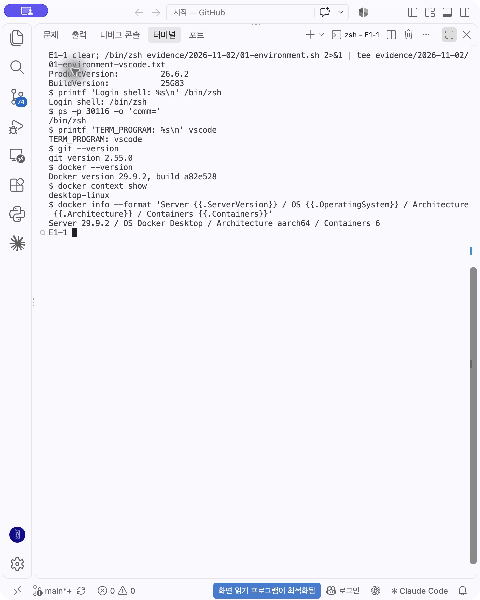
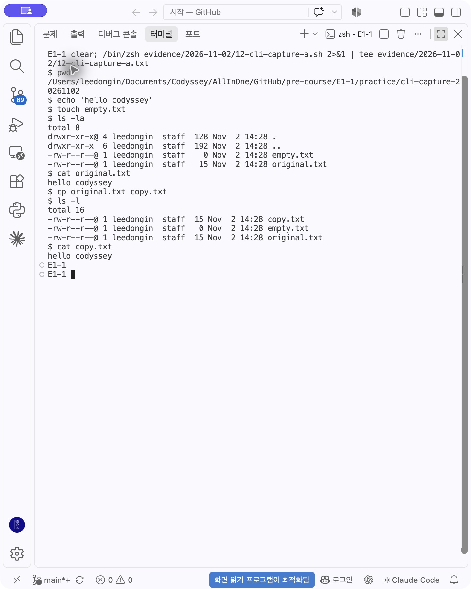
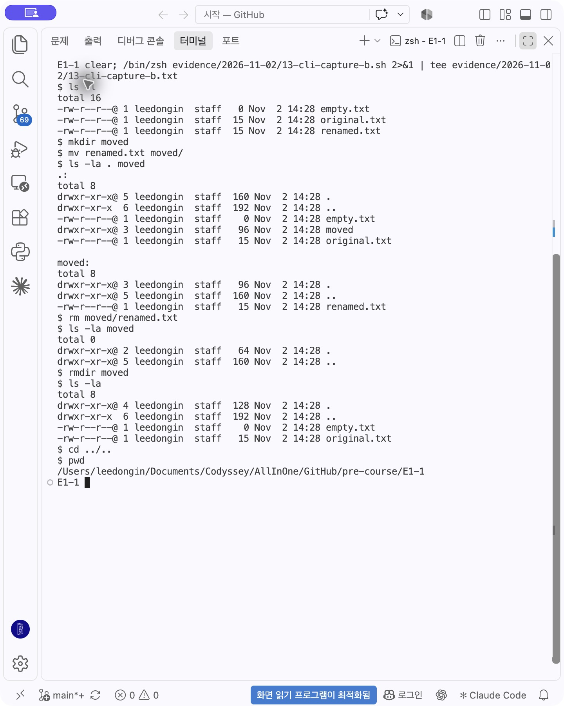
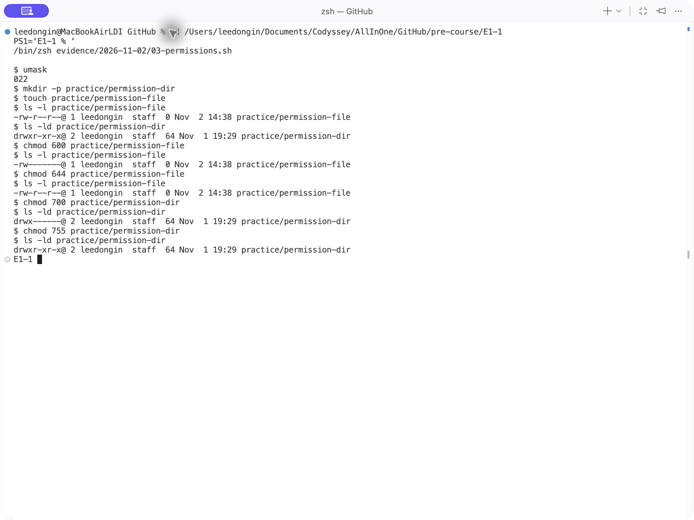
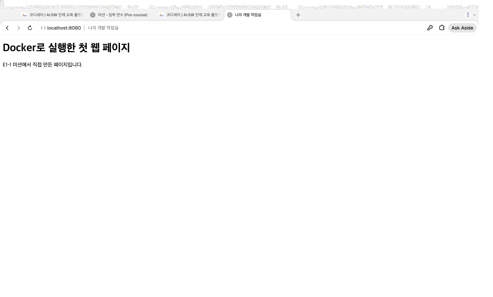
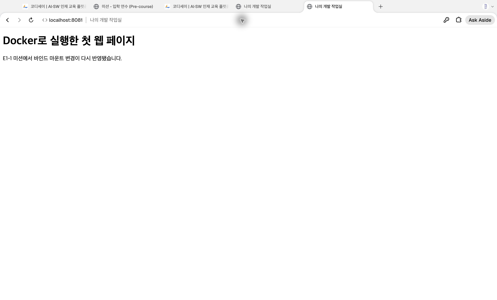
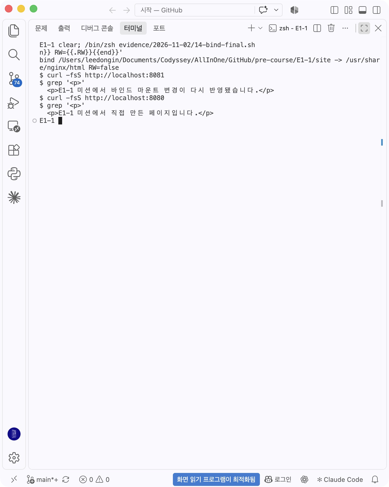
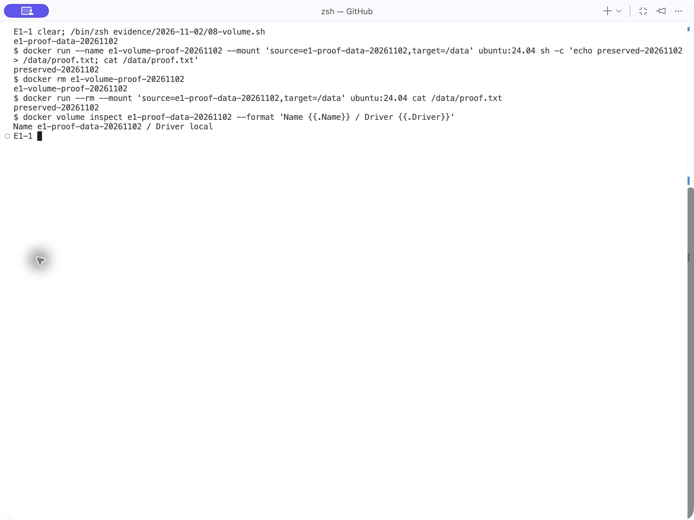
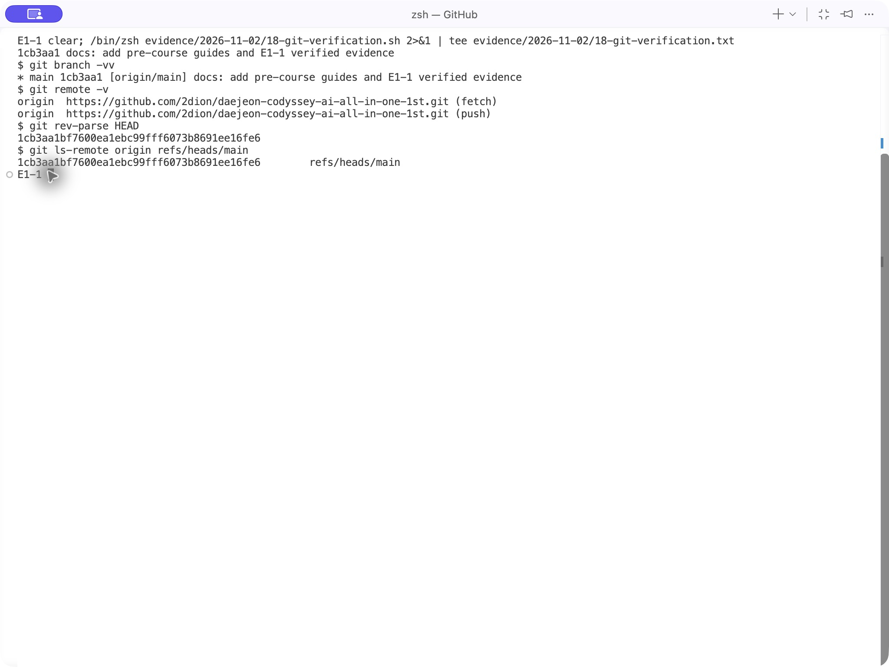
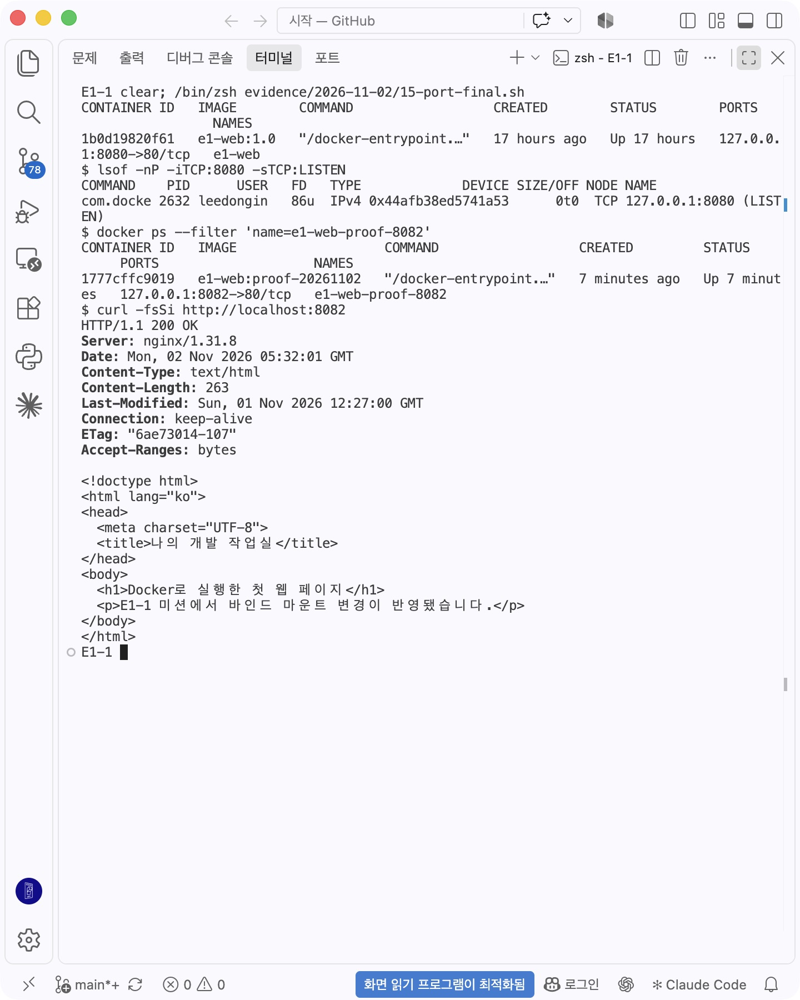

# E1-1: 내 컴퓨터에 개발자용 작업실 꾸미기

터미널·권한·Docker·Git을 사용해 개발 환경을 구성하고, NGINX 정적 웹 서버의 포트 매핑·바인드 마운트·볼륨 영속성을 검증한 기록이다.

**2026-11-02 보완 검증:** CLI 생성·복사·이동·삭제, 파일/디렉터리 권한 변화, 이미지 빌드, HTTP 접속, 바인드 마운트 전후, 볼륨 삭제 전후 검증을 수행했다. 아래 명령·로그·캡처는 실제 실행 결과다. 명령 실행과 문서·증거 정리에는 자동화 도구를 보조적으로 활용했다.

- [전체 실제 명령·출력](evidence/2026-11-02/LOGS.md)
- [증거 사진 목록](screenshots/README.md)
- [개념 학습 기록](미션%20사전%20질문과%20답변.md)
- GitHub 업로드·VS Code 연동 상태는 [Git 검증](#8-git과-github)을 참고한다.

## 문서 구성

- [미션 소개와 목표](#mission-goals): 학습 목표와 수행 항목
- [핵심 개념](#core-concepts): 도구의 역할과 동작 원리
- [평가 문항과 검증 근거](#peer-rubric): 미션 평가 기준별 구현·검증 내용
- [검증 흐름과 실행 상태 확인](#talk-scenario): 단계별 확인 방법과 주요 질문

실행 환경과 재현 절차는 1~2장, 실제 수행 결과와 증거는 3~9장에 정리했다.

<a id="mission-goals"></a>

## 0. 미션 소개와 목표

- 미션: **내 컴퓨터에 개발자용 '작업실' 꾸미기**
- 분야·구분: 입학연수 · 개발 입문 / 학습시간: 40시간 / 필수 미션
- 제출: GitHub Repository 링크. README에서 소스·설정·실행 로그·사진을 찾아볼 수 있어야 한다.
- 기준: 제공된 [Codyssey 미션](https://usr.codyssey.kr/daejeon/learning/learningMap?projectNo=154005)의 과제 목표와 동료평가 문항. 아래 문항별 표는 그 내용을 옮겨 설명·증거를 연결했다. AI 사전평가의 추가 제안을 별도의 필수 기준으로 확대하지 않는다.

**미션 개요**

터미널로 작업 환경을 다루고, Docker로 웹 서버를 실행해 포트·저장소 연결을 검증한 뒤 GitHub에 재현 가능한 기록을 남기는 과제다.

| 미션 목표 | 수행 내용 및 적용 개념 | 기록 위치 |
| --- | --- | --- |
| 절대 경로와 상대 경로의 차이를 예시로 설명 | 절대 경로는 루트부터 지정, 상대 경로는 기준 위치에서 해석. 마운트 source와 README 사진 링크를 비교 | [경로 개념](#concept-path), 2장·6장 |
| r/w/x와 755·644의 숫자 규칙 설명 | r=4·w=2·x=1, 소유자·그룹·그 외 순서. 파일 600→644·디렉터리 700→755 변화 | [권한 개념](#concept-permission), 4.2장 |
| 기존 Dockerfile을 기반으로 커스텀 이미지 제작 | nginx:alpine을 베이스로 선택하고 COPY로 직접 만든 정적 콘텐츠를 넣음 | 5장·[Dockerfile](Dockerfile) |
| 포트 매핑이 필요한 이유 설명 | 이번 macOS Docker 환경에서 호스트와 컨테이너의 네트워크 공간이 다르므로 8080→80으로 연결 | [포트 개념](#concept-port), 6장 |
| Docker 볼륨과 영속 데이터 설명 | 컨테이너 삭제와 데이터 수명을 분리하고, 같은 볼륨을 새 컨테이너에 연결해 다시 읽음 | [저장소 개념](#concept-storage), 7장 |
| Git과 GitHub의 역할 차이 설명 | Git은 로컬 버전 관리, GitHub는 원격 공유. commit과 push를 나눠 검증 | [Git·SSH 개념](#concept-git), 8장 |

미션은 터미널 명령의 실행뿐 아니라 **동작 구조·원리·문제 해결을 설명하는 능력**도 평가한다. 기능 실행 증거와 해당 동작의 원리를 함께 정리한다.

## 1. 실행 환경

| 항목 | 이번 검증 결과 |
| --- | --- |
| OS | macOS 26.6.2, Build 25G83 |
| 셸 | /bin/zsh |
| 터미널 | VS Code 통합 터미널(TERM_PROGRAM=vscode). 최초 수집 일부는 자동화 셸에서 실행 |
| Docker CLI / Server | 29.9.2 / 29.9.2 |
| Docker 실행 환경 | Docker Desktop, context desktop-linux, aarch64 |
| Git | 2.55.0 |
| 베이스 이미지 | nginx:alpine, ubuntu:24.04, hello-world |

macOS에 Ubuntu 자체를 설치한 것이 아니라 Docker의 Linux 실행 환경 안에서 Ubuntu 컨테이너를 실행했다. 실제 버전 출력은 [환경 로그](evidence/2026-11-02/01-environment.txt)에 있다. 컨테이너의 상태와 포트 점유는 검증 시점의 값이다.



## 2. 구성 기준과 재현 방법

```text
E1-1/
├── Dockerfile                 # 이미지를 만드는 지시문
├── site/index.html            # 이미지에 넣거나 마운트할 정적 콘텐츠
├── practice/                  # CLI·권한 실험 대상
├── evidence/2026-11-02/        # 실제 명령·출력과 수집에 사용한 스크립트
├── screenshots/               # 실제 브라우저·터미널 및 기존 증거 사진
├── 미션 사전 질문과 답변.md    # 개념 학습
└── README.md                  # 절차와 검증 결과의 진입점
```

이미지 재료, 실습 대상, 실행 증거를 역할별로 분리했다. README의 상대 링크는 저장소를 옮겨도 내부 관계를 유지한다. 비밀 파일과 OS 임시 파일은 상위 저장소의 .gitignore로 제외한다. 빈 디렉터리는 Git으로 저장되지 않으므로 권한 실습에서 mkdir로 생성한다.

다른 컴퓨터에서는 Docker를 실행하고 저장소 루트에서 다음 절차를 따른다. 아래 이름·포트가 이미 사용 중이면 먼저 상태를 확인하고 다른 이름이나 비어 있는 호스트 포트를 선택한다. `evidence/`의 .sh는 당시 수집 절차이며 일부는 의도적 충돌·삭제를 포함하므로 일괄 재실행용이 아니다.

```bash
cd pre-course/E1-1
pwd
cat Dockerfile
docker build -t e1-web:1.0 .
docker run -d --name e1-web -p 127.0.0.1:8080:80 e1-web:1.0
curl -fsSi http://localhost:8080
```

NGINX가 시작하기 전에 접속하면 실패할 수 있다. docker ps와 docker logs로 상태를 확인하고 다시 curl한다. 재현 시점의 site 내용으로 빌드하므로 과거 이미지의 문구와 다를 수 있다. nginx:alpine은 변할 수 있는 태그이며 바이트 단위로 동일한 빌드까지 보장하는 것은 아니다.

## 3. 수행 체크리스트

| 요구 항목 | 상태 | 증거 |
| --- | --- | --- |
| 경로·목록·생성·내용 확인·복사·이동·삭제 | 검증 완료 | [CLI 로그](evidence/2026-11-02/02-cli.txt), 아래 터미널 사진 |
| 파일·디렉터리 권한 실제 변화 | 검증 완료 | [권한 로그](evidence/2026-11-02/03-permissions.txt), 600→644·700→755 사진 |
| Docker 설치·엔진 점검 | 검증 완료 | [환경 로그](evidence/2026-11-02/01-environment.txt) |
| hello-world·Ubuntu·exec·stop | 검증 완료 | [기본 운영 로그](evidence/2026-11-02/04-docker-basics.txt) |
| 이미지/컨테이너 목록·정리 | 검증 완료 | [정리 로그](evidence/2026-11-02/09-cleanup.txt) |
| Dockerfile 빌드·실행·logs·stats | 검증 완료 | [빌드/운영 로그](evidence/2026-11-02/05-build.txt), [새 이미지 실행 로그](evidence/2026-11-02/07-port-conflict.txt) |
| 포트 매핑·브라우저 접속 | 검증 완료 | 아래 주소창 포함 8080·8081 사진, [최종 HTTP 200 로그](evidence/2026-11-02/11-http-final.txt) |
| 바인드 마운트 전후 | 검증 완료 | [변경 전후](evidence/2026-11-02/06-bind.txt), [정상 최종 응답](evidence/2026-11-02/14-bind-final.txt) |
| 볼륨 영속성 | 검증 완료 | [새 검증](evidence/2026-11-02/08-volume.txt), [기존 사진](screenshots/8.png) |
| Git 설정 | 검증 완료 | [이메일을 가린 설정 로그](evidence/2026-11-02/10-git-config.txt) |
| 커밋·푸시·VS Code 연동 | 검증 완료(계정 메뉴 사진 대신 관찰 기록) | 8장 실제 push·원격 해시·VS Code 관찰 기록 |
| 트러블슈팅 2건 이상 | 3건 기록 | 9장 |
| 보너스 5 · GitHub SSH | 인증·SSH 푸시 검증 완료 | 8.1장·19-ssh-bonus 로그 |

## 4. 터미널 기본 조작과 권한

### 4.1 생성·복사·이동·삭제

`practice/cli-proof-20261102`에서 파일을 만들고 복사했다. copy.txt를 renamed.txt로 바꾼 뒤 moved/로 옮기고 파일·빈 폴더를 삭제했다. 출력이 없는 cp·mv·rm은 다음 ls 목록으로 결과를 확인했다. [전체 텍스트 로그](evidence/2026-11-02/02-cli.txt)



실제 통합 터미널에서 별도 `cli-capture-20261102` 폴더를 사용해 생성·내용 확인·복사를 다시 실행한 사진이다.



이름 변경 후 renamed.txt가 보이고, 이동 후 moved/ 안에 보인다. rm 뒤에는 moved/가 비었으며, rmdir 뒤에는 상위 목록에서 moved/가 사라진다.

### 4.2 권한 변화

처음부터 644·755였던 대상을 같은 값으로 바꾸는 것은 변화 검증이 아니다. 이번에는 다음과 같이 실제로 다르게 설정했다. [전체 로그](evidence/2026-11-02/03-permissions.txt)

```console
$ chmod 600 practice/permission-file
$ ls -l practice/permission-file
-rw-------@ ... practice/permission-file
$ chmod 644 practice/permission-file
$ ls -l practice/permission-file
-rw-r--r--@ ... practice/permission-file
$ chmod 700 practice/permission-dir
$ ls -ld practice/permission-dir
drwx------@ ... practice/permission-dir
$ chmod 755 practice/permission-dir
$ ls -ld practice/permission-dir
drwxr-xr-x@ ... practice/permission-dir
```



r=4, w=2, x=1을 소유자·그룹·그 외 순서로 더한다. 644는 rw-/r--/r--, 755는 rwx/r-x/r-x다. 디렉터리의 x는 경로를 통과하는 권한이다. 현재 umask는 022였으며, 생성 시 요청된 모드에서 해당 권한 비트를 제거한다. 과거에도 같은 umask였다고 단정하지 않는다. macOS의 @는 확장 속성을 나타내며 rwx 숫자와 별개다.

## 5. Docker 기본 운영과 커스텀 이미지

[기본 운영 전체 로그](evidence/2026-11-02/04-docker-basics.txt)에 pull, images, hello-world, Ubuntu의 pwd/ls/echo, ps/ps -a, exec, stop 결과가 있다. 이번 Ubuntu 보완은 표준입력으로 bash에 명령을 전달했고, 기존 대화형 진입·exit 증거는 [4-4.png](screenshots/4-4.png)에 있다.

```console
$ docker run --name e1-hello-proof-20261102 hello-world
Hello from Docker!
$ docker exec e1-exec-proof-20261102 bash -c 'pwd; echo hello-from-exec'
/
hello-from-exec
```

bash가 주 프로세스인 컨테이너는 bash 종료 후 Exited (0)이었다. sleep infinity가 주 프로세스인 컨테이너는 exec 명령 종료 후에도 실행 중이었고 docker stop 이후 종료됐다. attach는 기존 주 프로세스의 입출력에 연결하고 exec는 새 프로세스를 실행한다. -it 자체가 컨테이너 수명을 유지하는 것은 아니다.

### 직접 작성한 Dockerfile

```Dockerfile
FROM nginx:alpine
COPY site/ /usr/share/nginx/html/
EXPOSE 80
```

- 베이스: 웹 서버가 포함된 nginx:alpine을 사용했다.
- 커스텀 목적: COPY로 직접 만든 site/index.html을 기본 웹 루트에 넣어 기본 페이지를 교체했다. 미션의 선택지 A에 해당한다.
- EXPOSE 80은 포트 안내이며 호스트 포트를 공개하지 않는다. 실제 연결은 run의 -p다.
- 이번 재빌드 태그는 e1-web:proof-20261102이며, 이 이미지로 8082 웹 컨테이너를 실행했다. 빌드 시 소스는 바인드 변경 전 문구였다.

[빌드 완료·image inspect·logs·stats](evidence/2026-11-02/05-build.txt) · [새 이미지 실행과 포트 변경](evidence/2026-11-02/07-port-conflict.txt) · [최종 8082 HTTP 200](evidence/2026-11-02/11-http-final.txt)

정리에서는 이번에 만든 종료 컨테이너 3개를 지정해 삭제했다. 임시 이미지 태그 e1-cleanup-proof:temporary도 삭제했다. 출력은 Untagged이며, 다른 태그가 참조하는 이미지 계층 전체가 삭제됐다는 뜻은 아니다. [목록·정리 전후](evidence/2026-11-02/09-cleanup.txt)

## 6. 포트 매핑과 바인드 마운트

### 6.1 주소창 포함 브라우저 증거



실제 Aside 주소창에 localhost:8080이 보이고, 본문은 “Docker로 실행한 첫 웹 페이지”, “E1-1 미션에서 직접 만든 페이지입니다.”다. 8080은 기존 이미지로 실행한 e1-web이다.



8081은 호스트 site/가 연결된 e1-bind다. 호스트 파일 변경 후 “바인드 마운트 변경이 다시 반영됐습니다.”가 보인다. [8080·8081·8082 최종 명령과 HTTP 200 응답](evidence/2026-11-02/11-http-final.txt)

### 6.2 마운트와 변경 전후

```bash
docker run -d --name e1-bind   -p 127.0.0.1:8081:80   --mount type=bind,source="$(pwd)/site",target=/usr/share/nginx/html,readonly   e1-web:1.0
```

명령은 E1-1 폴더에서 실행한다. source는 호스트의 절대 경로가 되고 target은 컨테이너 내부 경로다. readonly는 컨테이너 쪽 쓰기를 막으며 호스트 파일 수정은 가능하다.

이번에는 기존 e1-bind가 정확한 site/를 RW=false로 연결하고 실행 중임을 inspect로 확인했다. 같은 이름으로 새 run을 시도하면 충돌하므로 **새로 만들지 않고 기존 컨테이너를 재사용**했다. [이름 충돌 재현·inspect·변경 전후 원본](evidence/2026-11-02/06-bind.txt)

- 변경 전 8081: “바인드 마운트 변경이 반영됐습니다.”
- 호스트 변경 후 최종 8081: “바인드 마운트 변경이 다시 반영됐습니다.”
- 8080: “직접 만든 페이지입니다.” 유지.

수정 직후 첫 curl은 404였다. 그 순간의 원인은 확정하지 않았고, 파일 존재와 실제 응답을 재확인해 최종 HTTP 200·변경 문구를 확인했다. 초기 오류를 삭제하지 않고 원본에 남겼다. [최종 마운트·응답 비교](evidence/2026-11-02/14-bind-final.txt)



## 7. 볼륨 영속성

이번 보완은 기존 e1-data를 덮어쓰지 않고 별도 이름 e1-proof-data-20261102를 사용했다. [전체 명령·출력](evidence/2026-11-02/08-volume.txt)

```console
$ docker volume create e1-proof-data-20261102
e1-proof-data-20261102
$ docker run --name e1-volume-proof-20261102 --mount source=e1-proof-data-20261102,target=/data ubuntu:24.04 sh -c 'echo preserved-20261102 > /data/proof.txt; cat /data/proof.txt'
preserved-20261102
$ docker rm e1-volume-proof-20261102
e1-volume-proof-20261102
$ docker run --rm --mount source=e1-proof-data-20261102,target=/data ubuntu:24.04 cat /data/proof.txt
preserved-20261102
```

컨테이너를 지운 뒤 같은 볼륨을 새 컨테이너에 붙여 같은 내용을 읽었다. 컨테이너 쓰기 영역과 볼륨의 수명이 분리된다는 증거다. 다른 컴퓨터로 자동 이전되거나 볼륨 자체 삭제에도 데이터가 보존된다는 뜻은 아니다. docker rm -v는 익명 볼륨을 제거하며 이름 있는 이 볼륨은 제거하지 않는다. 기존 실습 증거도 [8.png](screenshots/8.png)에 남아 있다.



## 8. Git과 GitHub

설정에서 user.name=2dion, init.defaultBranch=main, origin의 HTTPS 주소를 확인했다. 이메일은 공개 로그에서 가렸고 그 외 불필요한 설정은 제외했다. [설정·초기 상태](evidence/2026-11-02/10-git-config.txt)

초기 상태는 No commits yet였으며 git ls-remote --heads origin 결과도 비어 있었다. 이 기록은 **보완 시작 시점**이다. 이후 커밋·푸시 결과는 별도로 기록한다.

2026-11-02 최초 업로드를 완료했다. 커밋 `1cb3aa1bf7600ea1ebc99fff6073b8691ee16fe6`을 main에 push한 뒤 로컬 HEAD와 원격 main의 해시가 같은 것을 확인했다. 이 검증 로그와 캡처를 추가하면서 문서 보완 커밋이 뒤따를 수 있다.

- [실제 commit·push·원격 해시 로그](evidence/2026-11-02/17-git-publish.txt)
- [VS Code GitHub 계정·저장소 인식 관찰 기록](evidence/2026-11-02/16-vscode-observation.md)
- [원격 저장소](https://github.com/2dion/daejeon-codyssey-ai-all-in-one-1st)

VS Code 계정 메뉴의 `2dion (GitHub)` 로그인을 확인했다. 같은 메뉴에 있는 다른 계정의 이메일을 공개하지 않도록 계정 메뉴 사진 대신 관찰 기록을 남겼다. 기존 이메일 포함 9-1.png도 제출에서 제외했다. 커밋에는 GitHub noreply 이메일을 사용했다.



Git은 로컬 버전 관리 도구이고 GitHub는 원격 저장소 공유 플랫폼이다. 로컬 커밋, 원격 push, VS Code 로그인·연동을 각각 확인한다. 최초 업로드는 HTTPS origin을 사용했으며, 아래 보너스 검증에서는 SSH URL을 직접 지정해 실제 푸시도 수행했다.

### 8.1 보너스 5: GitHub SSH 인증과 SSH 푸시

2026-11-02 기존 SSH 키로 GitHub의 `2dion` 계정 인증을 재확인했다. 새 키 생성·교체 없이 기존 설정을 사용했다. 키 파일이나 개인키 내용은 공개하지 않는다.

```console
$ ssh -T git@github.com
Hi 2dion! You've successfully authenticated, but GitHub does not provide shell access.
```

실제 확인 명령에는 BatchMode·접속 제한 시간·기존 호스트 키 검사 옵션을 추가했다. GitHub는 셸 접속을 제공하지 않아 이 인증 테스트가 성공 메시지와 함께 종료 코드 1을 반환한다. [GitHub 공식 안내](https://docs.github.com/en/authentication/connecting-to-github-with-ssh/testing-your-ssh-connection)

인증 성공과 저장소 push 권한은 별개이므로, 아래 SSH 주소로 이번 문서 커밋을 실제 push해 검증했다. 원래 origin의 HTTPS 설정은 유지하고 push 명령에 SSH URL을 직접 지정한다.

```bash
git push git@github.com:2dion/daejeon-codyssey-ai-all-in-one-1st.git main
git ls-remote git@github.com:2dion/daejeon-codyssey-ai-all-in-one-1st.git refs/heads/main
```

**검증 결과: SSH 인증과 실제 SSH 푸시 성공.** 커밋 `98aefe8731fe08a2909350011551dfe668ef0ed8`을 SSH로 올린 후, SSH로 조회한 원격 main 해시와 로컬 HEAD가 일치했다.

```console
$ git push git@github.com:2dion/daejeon-codyssey-ai-all-in-one-1st.git main
To github.com:2dion/daejeon-codyssey-ai-all-in-one-1st.git
   24b1ea2..98aefe8  main -> main
$ git ls-remote git@github.com:2dion/daejeon-codyssey-ai-all-in-one-1st.git refs/heads/main
98aefe8731fe08a2909350011551dfe668ef0ed8 refs/heads/main
```

[실제 인증·push·원격 해시 전체 로그](evidence/2026-11-02/19-ssh-bonus.txt). 이 결과 로그를 문서에 추가하는 보완 커밋은 위 검증 커밋 뒤에 이어진다.

GitHub에 등록된 공개키와 대응하는 개인키로 SSH 인증을 확인했다. SSH 주소로 변경 커밋을 push하고, 원격의 동일 커밋 반영 여부도 검증했다.

## 9. 트러블슈팅

### 사례 1. 컨테이너 이름 충돌: 기존 컨테이너 재사용

- 문제: e1-bind 이름으로 run을 시도하면 Conflict 오류가 발생했다. 기존 오류는 screenshots/7-1.png에도 있고 이번에도 의도적으로 재현했다.
- 가설: 이전에 생성한 컨테이너가 같은 이름을 점유했다.
- 확인: ps -a에서 e1-bind가 실행 중이며 inspect에서 현재 프로젝트 site/의 읽기 전용 bind mount를 확인했다.
- 해결/대안: 동일 설정의 컨테이너를 새로 만들 필요가 없어 기존 실행 컨테이너를 재사용했다. 불필요한 삭제를 하지 않았다.
- 결과: 호스트 수정 후 8081에서 변경 문구와 HTTP 200을 확인했다. 초기 404와 재확인 결과를 함께 보존했다.
- 증거: [06-bind](evidence/2026-11-02/06-bind.txt), [11-http-final](evidence/2026-11-02/11-http-final.txt), [14-bind-final](evidence/2026-11-02/14-bind-final.txt).

### 사례 2. chmod 실행은 성공했지만 변화가 없는 검증

- 문제: 기존 스크린샷 2-1.png에서 이미 파일은 644·디렉터리는 755여서 동일 값 chmod 후 변화가 없었다.
- 가설: chmod 실패 또는 처음부터 같은 모드.
- 확인: 최초 캡처의 권한과 현재 ls 출력을 비교했다. 이번 umask는 022였다.
- 조치: 파일을 600→644, 디렉터리를 700→755로 바꾸고 매번 ls 출력으로 비교했다.
- 결과: rw-------→rw-r--r--, rwx------→rwxr-xr-x 변화 확인. 이는 서비스 장애가 아니라 실험·검증 방법을 바로잡은 사례다.
- 증거: [권한 로그](evidence/2026-11-02/03-permissions.txt), [터미널 사진](screenshots/20261102-terminal-permissions.png).

### 사례 3. 호스트 8080 포트 충돌: 의도적 재현

- 문제: 기존 e1-web이 8080을 사용하는 상태에서 새 컨테이너를 같은 포트로 실행해 port is already allocated가 발생했다.
- 가설: 다른 컨테이너 또는 호스트 프로세스가 점유 중이다.
- 확인: docker ps --filter publish=8080에서 e1-web, lsof에서 Docker의 중계 프로세스가 보였다.
- 조치: 실패 후 Created 상태로 남은 실습 컨테이너만 삭제하고 새 컨테이너의 호스트 포트를 8082로 바꿨다. 컨테이너 포트는 80을 유지했다.
- 결과: 시작 직후 첫 요청은 Empty reply였고, 이후 재검증에서 8082의 HTTP 200과 본문을 확인했다. 즉시 응답하지 않는 것과 최종 실행 실패를 구분했다.
- 증거: [충돌·조치 원본](evidence/2026-11-02/07-port-conflict.txt), [최종 진단·응답](evidence/2026-11-02/15-port-final.txt).



<a id="core-concepts"></a>

## 10. 핵심 개념과 적용

### 10.1 터미널·셸·CLI와 기본 명령

**터미널**은 글자로 명령을 입력하고 결과를 보여 주는 화면이고, **셸**은 입력된 명령을 해석해 실행하는 프로그램이다. **CLI**는 명령어로 컴퓨터를 조작하는 방식이다. 이번 환경은 VS Code 통합 터미널과 zsh다. macOS의 셸을 사용했고, Ubuntu 명령 실습은 별도의 컨테이너 내부에서 했다.

| 명령 | 의미 | 이 과제에서 결과를 확인한 방법 |
| --- | --- | --- |
| pwd / cd | 현재 작업 위치 출력 / 작업 위치 이동 | 이동 전후 pwd 비교 |
| ls -la | 숨김 항목까지 포함한 상세 목록 | 파일 존재·이름·권한 확인 |
| mkdir / touch | 디렉터리 생성 / 파일이 없으면 빈 파일 생성, 있으면 시각 갱신 | 목록과 파일 크기 확인 |
| cat | 파일 내용 출력 | original.txt와 copy.txt 내용 확인 |
| cp / mv | 복사 / 이동 또는 이름 변경 | 전후 목록에서 copy.txt·renamed.txt·moved/ 비교 |
| rm / rmdir | 파일 등 삭제 / 빈 디렉터리 삭제 | 삭제 후 목록에서 대상이 사라졌는지 확인 |

> **요약:** 명령을 입력했다는 것만으로 성공을 판단하지 않고, pwd·ls·cat 결과로 위치·이름·내용이 어떻게 바뀌었는지 확인했다.

<a id="concept-path"></a>

### 10.2 절대 경로와 상대 경로: 차이와 선택 기준

- **절대 경로:** `/`부터 시작하는 전체 경로. 현재 작업 위치에 관계없이 같은 대상을 지정해야 할 때 사용한다. 예: `/usr/share/nginx/html`은 컨테이너 안의 절대 경로다.
- **상대 경로:** 현재 작업 위치 또는 해당 문서·도구의 기준 위치에서 해석한다. 예: 셸의 `./site`는 현재 디렉터리 기준이고 README의 `screenshots/...`는 문서 위치 기준이다.
- **선택:** 프로젝트 내부 파일 관계는 상대 경로로 유지하면 다른 위치에 복제해도 연결하기 쉽다. 호스트 마운트 source를 명확히 지정할 때는 이번처럼 `$(pwd)/site`로 절대 경로를 만든다. `pwd`의 기준이 틀리면 다른 폴더가 되므로 E1-1에서 실행해야 한다.
- Dockerfile의 `COPY site/`에서 source는 호스트 빌드 컨텍스트 기준이다. 이번 `docker build ... .`에서는 E1-1이 빌드 컨텍스트다.

> **요약:** 어디서 실행해도 같은 대상을 지정하려면 절대 경로를, 저장소 내부의 위치 관계를 유지하려면 상대 경로를 사용한다. 다만 각각 무엇을 기준으로 해석하는지도 확인해야 한다.

<a id="concept-permission"></a>

### 10.3 파일·디렉터리 권한

r은 읽기, w는 쓰기, x는 실행 권한이며 각각 4·2·1이다. 소유자·그룹·그 외 사용자 순서로 세 자리 숫자를 쓴다.

| 숫자 | 소유자 | 그룹 | 그 외 | 이번 실습에서의 의미 |
| --- | --- | --- | --- | --- |
| 600 | rw- | --- | --- | 파일을 소유자만 읽고 쓸 수 있음 |
| 644 | rw- | r-- | r-- | 소유자만 쓰고 다른 사용자는 읽을 수 있음 |
| 700 | rwx | --- | --- | 디렉터리를 소유자만 사용할 수 있도록 제한 |
| 755 | rwx | r-x | r-x | 다른 사용자도 디렉터리를 읽고 경로를 통과할 수 있음 |

디렉터리에서 r은 내부 이름 목록을 읽는 권한, x는 경로를 통과하는 권한이다. 파일 삭제는 파일 자신의 w만으로 결정되지 않으며 부모 디렉터리 권한도 관계한다. 이번 실습에서는 일반적인 rwx·숫자 해석과 실제 변경 전후를 확인했다.

> **요약:** 644의 6은 4+2라 읽기·쓰기, 4는 읽기만이다. 755의 7은 읽기·쓰기·실행이고, 디렉터리의 실행 권한은 그 경로를 통과하는 데 필요하다.

### 10.4 Docker 엔진·이미지·컨테이너·Dockerfile

- **Docker CLI:** 터미널의 docker 명령. Docker 엔진에 작업을 요청한다.
- **Docker 엔진:** 이미지·컨테이너를 실제로 관리하고 실행한다. CLI 버전 출력만으로 엔진 연결까지 확인됐다고 보지 않고 docker info도 확인했다.
- **Dockerfile:** 이미지를 만드는 지시문을 적은 텍스트 파일이다.
- **이미지:** 프로그램·필요 파일·실행 설정이 담긴 읽기 전용 계층의 묶음이다.
- **컨테이너:** 이미지에서 생성한 실행 단위다. 각 컨테이너는 자체 상태와 쓰기 영역을 가지며, 주 프로세스가 종료되면 일반적으로 실행도 종료된다.

```text
Dockerfile + site/index.html
          │ docker build
          ▼
        이미지
          │ docker run
          ▼
       컨테이너
```

**빌드·실행·변경의 구분**

| 관점 | 의미 | 프로젝트 적용 내용 |
| --- | --- | --- |
| 빌드 | Dockerfile과 소스를 처리해 이미지 생성 | nginx:alpine + COPY site/ |
| 실행 | 이미지로 컨테이너 생성·시작 | e1-web 또는 e1-web-proof-8082 실행 |
| 변경 | 호스트 소스·이미지·컨테이너 쓰기 영역은 각각 구분 | 호스트 HTML 수정만으로 기존 이미지가 자동 갱신되지 않음 |

Dockerfile 세 줄은 **FROM: NGINX가 있는 베이스 선택 → COPY: 자체 페이지로 교체 → EXPOSE: 사용 포트 안내**로 읽는다. 컨테이너 안에서 파일을 바꿔도 원본 이미지에 자동 저장되지 않는다. 이미지를 갱신해 서비스에 적용하려면 보통 재빌드 후 그 이미지로 컨테이너를 다시 만든다.

> **요약:** Dockerfile은 만드는 방법, 이미지는 그 방법으로 만든 실행 재료, 컨테이너는 그 재료로 만든 개별 실행 단위이다.

### 10.5 run·exec·attach, 중지와 삭제

- `run`: 새 컨테이너를 만들어 실행한다. 같은 이름이 이미 남아 있으면 충돌한다.
- `exec`: 실행 중인 컨테이너에서 새 프로세스를 실행한다.
- `attach`: 이미 실행 중인 주 프로세스의 입출력에 연결한다. 새 셸을 만드는 명령은 아니다.
- `stop`: 주 프로세스를 중지한다. 컨테이너 자체는 남는다.
- `rm`: 컨테이너를 삭제한다. 컨테이너의 쓰기 영역도 함께 사라진다.
- `-it`: 표준입력을 유지하고 터미널을 할당하는 옵션이다. 그 옵션 자체가 컨테이너를 계속 실행시키지는 않는다.

> **요약:** 이번에는 bash가 주 프로세스인 컨테이너에서 exit하자 종료됐다. sleep infinity가 주 프로세스인 컨테이너에서는 exec로 추가한 명령이 끝나도 주 프로세스가 살아 있어 실행 상태가 유지됐다.

<a id="concept-port"></a>

### 10.6 포트 매핑과 localhost

**포트**는 네트워크에서 서비스를 구분하는 번호다. **localhost**는 요청을 보내는 환경 자기 자신을 뜻한다. 이번 macOS Docker 기본 구성에서는 컨테이너의 격리된 네트워크 공간과 맥의 네트워크 공간이 다르고, Linux 컨테이너는 Docker Desktop의 Linux 실행 환경 안에 있다. 따라서 맥의 localhost:80을 컨테이너의 80번과 같은 곳으로 보면 안 된다.

```text
브라우저·curl
     │ http://localhost:8080
     ▼
맥의 127.0.0.1:8080
     │ -p 127.0.0.1:8080:80
     ▼
컨테이너의 NGINX :80
```

| 부분 | 뜻 |
| --- | --- |
| 127.0.0.1 | 호스트의 로컬 주소에 연결 |
| 왼쪽 8080 | 호스트에서 접속할 포트 |
| 오른쪽 80 | 컨테이너 안에서 NGINX가 사용하는 포트 |
| EXPOSE 80 | 이미지가 사용하는 포트를 알리는 정보. 이것만으로 호스트 접속 포트가 생기지는 않음 |

> **요약:** 이번 구성에서는 맥의 8080 요청을 컨테이너의 80으로 전달해야 하므로 포트 매핑이 필요하다. 모든 Docker 네트워크 방식에서 직접 접속이 불가능하다는 뜻은 아니다.

<a id="concept-storage"></a>

### 10.7 바인드 마운트·볼륨·영속성

**마운트**는 외부 저장 공간을 컨테이너 내부 경로에 연결하는 것이다. **영속성**은 이번 검증에서는 컨테이너를 삭제해도 보존 대상 데이터를 다시 사용할 수 있다는 뜻이다.

| 구분 | 저장 위치·관리 | 사용하는 상황 | 이번 증거 |
| --- | --- | --- | --- |
| 컨테이너 쓰기 영역 | 컨테이너에 속하는 변경 영역 | 없어져도 되는 임시 상태 | 컨테이너 삭제와 수명이 연결됨 |
| 바인드 마운트 | 호스트의 지정 파일·폴더 | 개발 중 소스 수정과 확인 | site/ 수정 후 8081 본문 변경 |
| 이름 있는 볼륨 | Docker가 관리하는 저장 공간 | 컨테이너 교체 후에도 남길 데이터 | e1-proof-data-20261102 재연결 후 동일 문자열 |

바인드 마운트도 호스트에 데이터가 남으면 컨테이너 밖에서 보존할 수 있다. “바인드는 변경 반영만 가능하고 영속성이 없다”라고 구분하지 않는다. 이번에 **각각 검증한 목적**이 변경 반영과 볼륨 영속성으로 다른 것이다. 볼륨은 이름 없이 익명으로도 만들 수 있지만 이번에는 재사용 대상을 명확히 지정하려고 이름을 붙였다.

> **요약:** 바인드는 지정한 호스트 폴더를 연결하고, 볼륨은 Docker가 관리하는 공간을 연결한다. 이번에는 바인드로 소스 변경을 확인하고 볼륨으로 컨테이너 삭제 후 데이터 재사용을 확인했다.

<a id="concept-git"></a>

### 10.8 Git·GitHub·커밋·푸시·SSH

| 개념 | 설명 |
| --- | --- |
| Git | 로컬 파일 변경 이력을 커밋과 브랜치로 관리하는 도구 |
| commit | 스테이징한 변경을 로컬 이력으로 기록 |
| GitHub | Git 저장소를 원격으로 공유하고 협업하는 서비스 |
| push | 로컬 커밋을 원격 저장소에 전달 |
| origin / main | 관례적인 원격 저장소 별칭 / 이번 작업 브랜치 이름 |
| SSH | 암호화된 접속·인증 방식. 공개키는 GitHub에 등록하고 개인키는 로컬에서 보관 |

SSH 인증 테스트 성공은 계정에 인증됐다는 의미이고, 실제 push 성공은 해당 저장소에 변경을 올릴 수 있다는 별도의 증거다. 이번에는 기존 키로 인증한 뒤 SSH URL로 문서 커밋을 push하고 원격 해시까지 비교했다. origin 설정은 HTTPS로 유지했다.

> **요약:** 커밋은 로컬 기록이고 push해야 GitHub에 반영된다. SSH 보너스는 인증 테스트에서 끝내지 않고 실제 SSH 푸시와 원격 반영까지 확인했다.

<a id="peer-rubric"></a>

## 11. 미션 평가 문항과 검증 근거

아래 1~4항목의 **18개 세부 문항**은 제공된 동료평가 문항을 기준으로 한다. 각 문항에 관련 개념, 수행 결과와 증거를 연결했다. 문서·로그는 수행 증거이고, 설명 능력과 PASS/FAIL 및 보너스 크레딧의 최종 판정은 평가자가 결정한다.

### 항목 1. 기능 동작 검증

| 평가 문항 | 관련 개념 및 검증 내용 | 근거 |
| --- | --- | --- |
| 터미널에서 기본 명령어로 폴더/파일 생성·이동·삭제를 수행한 흔적이 있는가? | pwd·cd로 작업 위치를 확인하고 파일을 생성·복사·이름 변경·이동·삭제했다. 결과가 출력되지 않는 명령은 다음 ls 목록으로 변화가 있는지 확인했다. | [CLI 명령·출력](evidence/2026-11-02/02-cli.txt) · [생성·복사 사진](screenshots/20261102-terminal-cli-a.png) · [이동·삭제 사진](screenshots/20261102-terminal-cli-b.png) |
| 파일 권한 변경 결과가 확인되는가? | 파일은 600→644, 디렉터리는 700→755로 바꿨고 ls의 권한 문자열 차이를 확인했다. 같은 값을 다시 설정한 최초 기록의 검증 부족을 보완했다. | [권한 로그](evidence/2026-11-02/03-permissions.txt) · [전후 사진](screenshots/20261102-terminal-permissions.png) |
| `docker --version`이 출력되고, Docker가 동작 가능한 상태인가? | docker --version으로 CLI 버전을 확인하고, docker info의 Server 정보로 엔진 연결도 확인했다. 현재 실행 가능 여부는 평가 때 다시 확인한다. | [버전·엔진 연결 로그](evidence/2026-11-02/01-environment-vscode.txt) |
| `docker run hello-world`가 정상 실행되는가? | hello-world를 실행해 Hello from Docker!를 받았다. 메시지 출력 후 주 프로세스가 종료되므로 종료된 컨테이너 목록에서 확인할 수 있다. | [hello-world·ps/ps -a 로그](evidence/2026-11-02/04-docker-basics.txt) |
| 이미지/컨테이너 목록 확인 및 정리 흔적이 있는가? | images와 ps -a로 목록을 확인한 뒤 이번 실습의 종료 컨테이너 3개와 임시 이미지 태그를 지정해 정리했다. Untagged는 태그 제거이며 공유 계층 전체 삭제와 구분한다. | [목록·정리 전후 로그](evidence/2026-11-02/09-cleanup.txt) |
| Dockerfile로 이미지 빌드가 가능한가? | NGINX 베이스에 자체 HTML을 COPY하는 Dockerfile을 작성해 빌드했다. 새 이미지로 실행한 컨테이너의 8082 접속까지 확인했다. | [Dockerfile](Dockerfile) · [빌드 로그](evidence/2026-11-02/05-build.txt) · [실행 로그](evidence/2026-11-02/07-port-conflict.txt) |
| 매핑된 포트로 접속이 가능한가? | 호스트 8080·8081·8082에서 최종 HTTP 200을 확인했고, 8080·8081은 주소창과 본문이 보이는 브라우저 사진도 남겼다. | [최종 응답](evidence/2026-11-02/11-http-final.txt) · [8080 사진](screenshots/20261102-browser-8080.png) · [8081 사진](screenshots/20261102-browser-8081.png) |
| Docker 볼륨 데이터가 컨테이너 삭제 후에도 유지되는가? | 같은 이름의 볼륨에 파일을 쓰고 첫 컨테이너를 삭제한 뒤 새 컨테이너에서 preserved-20261102를 다시 읽었다. 컨테이너와 볼륨의 수명이 분리된 증거이다. | [생성·쓰기·삭제·재연결 로그](evidence/2026-11-02/08-volume.txt) · [사진](screenshots/20261102-terminal-volume.png) |
| Git 설정 및 GitHub 연동이 확인되는가? | 사용자 정보와 기본 브랜치를 확인하고 commit·push했다. VS Code 계정과 저장소 인식은 관찰 기록에, 실제 업로드는 push와 원격 해시에 따로 남겼다. 계정 메뉴 사진은 개인정보 때문에 제외했다. | [설정](evidence/2026-11-02/10-git-config.txt) · [push](evidence/2026-11-02/17-git-publish.txt) · [VS Code 관찰](evidence/2026-11-02/16-vscode-observation.md) |

평가 결과: 평가자가 **PASS / FAIL**로 판정한다.

### 항목 2. 동작 구조 설계

| 평가 문항 | 관련 개념 및 검증 내용 | 근거 |
| --- | --- | --- |
| 프로젝트 디렉토리 구조를 어떤 기준으로 구성했는지 설명할 수 있는가? | 이미지를 만드는 Dockerfile·site, 실습 대상 practice, 실제 증거 evidence·screenshots로 역할을 나눴다. README를 진입점으로 두어 실행 방법과 결과를 함께 찾게 했다. | 2장 디렉터리 구조 · [실제 파일 목록](.) |
| 포트/볼륨 설정을 어떤 방식으로 재현 가능하게 정리했는지 설명할 수 있는가? | 실행 위치, 이미지 태그, 컨테이너·볼륨 이름, 호스트/내부 포트, 마운트 source/target을 명령에 남겼다. 경로는 E1-1에서 해석하고 이름·포트 충돌 시 상태를 확인하도록 안내했다. 다른 기기로 기존 볼륨 데이터까지 자동 전송되지는 않는다. | 2장 재현 방법 · 6.2장 마운트 명령 · 7장 볼륨 절차 |

평가 결과: 평가자가 **PASS / FAIL**로 판정한다.

### 항목 3. 핵심 기술 원리 적용

| 평가 문항 | 관련 개념 및 검증 내용 | 근거 |
| --- | --- | --- |
| 이미지와 컨테이너의 차이를 "빌드/실행/변경" 관점에서 구분해 설명할 수 있는가? | build로 읽기 전용 이미지를 만들고 run으로 컨테이너를 만든다. 컨테이너에는 개별 쓰기 영역이 있으며 그 변경이 이미지로 자동 저장되지 않는다. 호스트 소스 변경도 COPY된 이미지에는 재빌드 없이 반영되지 않는다. | [개념 10.4](#core-concepts) · 5장 빌드 · 6장 기존 이미지/바인드 응답 비교 |
| 컨테이너 내부 포트로 직접 접속할 수 없는 이유와 포트 매핑이 필요한 이유를 설명할 수 있는가? | 이번 macOS Docker 기본 구성에서 맥과 컨테이너는 서로 다른 네트워크 공간이다. 맥의 localhost:80은 컨테이너의 80이 아니어서 호스트 8080→컨테이너 80 매핑을 사용했다. EXPOSE만으로 연결되지는 않는다. | [포트 개념](#concept-port) · 6장 브라우저·HTTP 증거 |
| 절대 경로/상대 경로를 어떤 상황에서 선택하는지 설명할 수 있는가? | 현재 위치와 무관하게 대상을 지정할 때 절대 경로를, 프로젝트 내부 관계를 유지할 때 상대 경로를 사용한다. 마운트에는 $(pwd)/site, 문서에는 screenshots/...를 사용했다. 각 경로는 실행 위치 또는 문서 위치를 기준으로 해석된다. | [경로 선택 기준](#concept-path) · 6.2장 source/target |
| 파일 권한 숫자 표기(예: 755, 644)가 어떤 규칙으로 결정되는지 설명할 수 있는가? | r=4·w=2·x=1을 더해 소유자·그룹·그 외 순서로 사용한다. 755는 rwx/r-x/r-x, 644는 rw-/r--/r--이다. 디렉터리 x는 경로 통과 권한이다. | [권한 개념](#concept-permission) · 4.2장 실제 변경 |

평가 결과: 평가자가 **PASS / FAIL**로 판정한다.

### 항목 4. 심층 인터뷰

| 평가 문항 | 관련 개념 및 검증 내용 | 근거 |
| --- | --- | --- |
| "호스트 포트가 이미 사용 중"이라 포트 매핑이 실패한다면, 어떤 순서로 원인을 진단할지 설명할 수 있는가? | 오류 문구를 읽고 이름 충돌과 포트 충돌을 구분한다. docker ps의 publish 필터로 컨테이너를 확인하고 lsof로 호스트 프로세스를 확인한다. 기존 서비스가 필요하면 새 호스트 포트로 바꾸고 curl로 검증한다. | 9장 사례 3 · [진단·포트 변경](evidence/2026-11-02/07-port-conflict.txt) · [최종 200](evidence/2026-11-02/15-port-final.txt) |
| 컨테이너 삭제 후 데이터가 사라진 경험이 있다면, 이를 방지하기 위한 대안을 설명할 수 있는가? | 이번 실습에서는 컨테이너 삭제 후 같은 볼륨의 데이터를 재사용하는 구조를 검증했다. 컨테이너 쓰기 영역 대신 이름 있는 볼륨이나 바인드를 쓰고 새 컨테이너에 같은 저장 공간을 연결한다. 볼륨 자체 삭제·디스크 고장에는 별도 백업이 필요하다. | [저장소 원리](#concept-storage) · 7장 삭제 후 동일 데이터 재확인 |
| 이 미션에서 가장 어려웠던 지점과 해결 과정(가설 → 확인 → 조치)을 근거와 함께 설명할 수 있는가? | 주요 문제는 명령 실행 기록만으로 권한 변화를 입증할 수 없었다는 점이다. chmod 실패인지 원래 같은 값인지 가설을 세우고 최초 권한을 확인했다. 600·700을 거쳐 644·755로 바꾸고 실제 문자열 차이로 검증했다. | 9장 사례 2 · [권한 전후 로그](evidence/2026-11-02/03-permissions.txt) |

평가 결과: 평가자가 **PASS / FAIL**로 판정한다.

### 항목 5. 보너스 문제 해결에 따른 크레딧 부여

보너스 과제 5가지 중 **5번 GitHub SSH 키 설정·SSH 푸시**를 검증했다. 기존 등록 키를 재사용했으며 새 키 생성은 수행하지 않았다.

| 보너스 과제 | 이번 기록 |
| --- | --- |
| 1. Docker Compose 기초 | 미수행 |
| 2. Docker Compose 멀티 컨테이너 | 미수행 |
| 3. Compose 운영 명령 up·down·ps·logs | 미수행 |
| 4. 환경 변수 활용 | 미수행 |
| 5. GitHub SSH 키 설정 및 SSH 푸시 확인 | 기존 키 인증 + 실제 SSH push + 원격 해시 일치 확인 |

> **요약:** 등록된 공개키에 대응하는 개인키로 GitHub 인증을 확인했다. 인증만으로 끝내지 않고 SSH 주소로 문서 커밋을 실제 push한 뒤 원격 반영도 확인했다. origin 설정은 HTTPS로 유지했지만 해당 push 명령에는 SSH URL을 직접 지정했다.

증거: [8.1장 SSH 검증](#81-보너스-5-github-ssh-인증과-ssh-푸시) · [실제 SSH 인증·push 로그](evidence/2026-11-02/19-ssh-bonus.txt). 최종 크레딧은 평가자가 **부여 / 미부여**로 판정한다.

<a id="talk-scenario"></a>

## 12. 검증 흐름과 실행 상태 확인

| 단계 | 확인 대상 | 검증 내용 | 판별 기준 |
| --- | --- | --- | --- |
| 1 | 실행 환경·디렉터리 구조 | 도구 버전, Docker 엔진 연결, 소스·실습·증거의 역할 분리 | 1~2장의 환경 정보와 실제 구성 일치 |
| 2 | CLI·파일 권한 | 생성·복사·이동·삭제 및 파일 600→644·디렉터리 700→755 | 파일 목록·내용·권한 문자열의 전후 차이 |
| 3 | Dockerfile·이미지·컨테이너 | NGINX 베이스 선택, 정적 콘텐츠 복사, 빌드·실행 | 빌드 완료와 생성한 이미지의 컨테이너 실행 |
| 4 | 포트·바인드 마운트 | 호스트 8080→컨테이너 80 연결, 8081의 호스트 파일 변경 반영 | 브라우저 주소창·HTTP 응답·마운트 정보·본문 비교 |
| 5 | 볼륨 | 쓰기→첫 컨테이너 삭제→같은 볼륨을 새 컨테이너에 연결 | 삭제 전후 동일한 preserved-20261102 출력 |
| 6 | 문제 해결 | 컨테이너 이름·포트 충돌에 대한 가설·확인·조치 | 기존 컨테이너 재사용, 호스트 포트 변경 후 HTTP 200 |
| 7 | GitHub·SSH | 로컬 커밋의 원격 반영과 실제 SSH 푸시 | push 성공 및 로컬·원격 커밋 해시 일치 |

### 12.1 현재 실행 상태 확인

아래 명령은 현재 실행 상태를 확인하는 절차다. 저장된 로그는 검증 당시의 결과이며 현재 컨테이너 상태와 다를 수 있다. Docker Desktop 실행 후 E1-1에서 확인한다.

```bash
cd pre-course/E1-1
pwd
docker --version
docker info --format 'Server {{.ServerVersion}} / {{.OperatingSystem}}'
docker ps -a
```

웹 컨테이너가 실행 중이면 접속과 마운트를 확인한다. 컨테이너가 없거나 중지된 경우에는 2장의 재현 절차와 기록 당시의 증거를 구분해 확인한다.

```bash
curl -fsSi http://localhost:8080
curl -fsSi http://localhost:8081
docker inspect e1-bind --format '{{range .Mounts}}{{.Type}} {{.Source}} -> {{.Destination}} RW={{.RW}}{{end}}'
```

볼륨이 실제로 존재하는지 먼저 확인하고, 존재할 때만 읽기 전용으로 연결해 내용을 읽는다. 볼륨이 없는 경우 현재 환경에서는 해당 데이터를 조회할 수 없으므로, 재현 실험과 기존 검증 기록을 구분한다.

```bash
docker volume inspect e1-proof-data-20261102
docker run --rm --mount source=e1-proof-data-20261102,target=/data,readonly ubuntu:24.04 cat /data/proof.txt
```

### 12.2 주요 질문과 확인 범위

| 질문·상황 | 설명 |
| --- | --- |
| HTML을 수정했는데 왜 8080은 그대로인가? | 빌드 시 COPY된 파일을 사용하기 때문이다. 호스트 파일 변경이 기존 이미지에 자동 반영되지 않는다. |
| 8082의 문구가 8081과 다른 이유는? | 보완 이미지는 마지막 호스트 수정 전에 빌드했다. 기록 당시 8080은 최초 문구, 8082는 변경 문구, 8081은 다시 반영 문구였다. 현재 재빌드하면 달라질 수 있다. |
| readonly인데 호스트에서 왜 수정되나? | 컨테이너 쪽 마운트의 쓰기를 제한한 것이다. 호스트의 파일 수정까지 금지하는 설정은 아니다. |
| 이름 충돌 때 기존 것을 삭제했나? | 이번에는 기존 e1-bind의 상태와 마운트를 확인해 재사용했다. 중복 실행을 대체한 조치는 기존 컨테이너 재사용이다. |
| 404·Empty reply의 정확한 원인은? | 수정·시작 직후 발생한 사실은 확인했지만 원인을 확정하지 않았다. 로그를 보존하고 이후 상태·HTTP 200을 확인했다. |
| 볼륨이면 영원히 안전한가? | 아니다. 컨테이너 삭제와의 수명을 분리할 뿐 볼륨 자체 삭제·디스크 고장은 별도 백업으로 대비해야 한다. |
| GitHub 로그인 사진은 어디 있나? | 개인정보가 함께 표시돼 계정 메뉴 사진은 제외했다. 관찰 기록과 실제 push·원격 해시가 관련 근거이며, 로그인 상태는 VS Code에서 별도로 확인할 수 있다. |
| 자동화 도구의 활용 범위는? | 실습 명령 실행과 문서·증거 정리에 보조적으로 활용했다. 실행 결과는 명령 출력·사진·원격 커밋 기록으로 확인할 수 있다. |

검증 결과는 연결된 명령 출력·사진을 기준으로 확인한다. 원인이 확정되지 않은 오류와 현재 상태가 달라질 수 있는 항목은 해당 범위를 명시했다.
