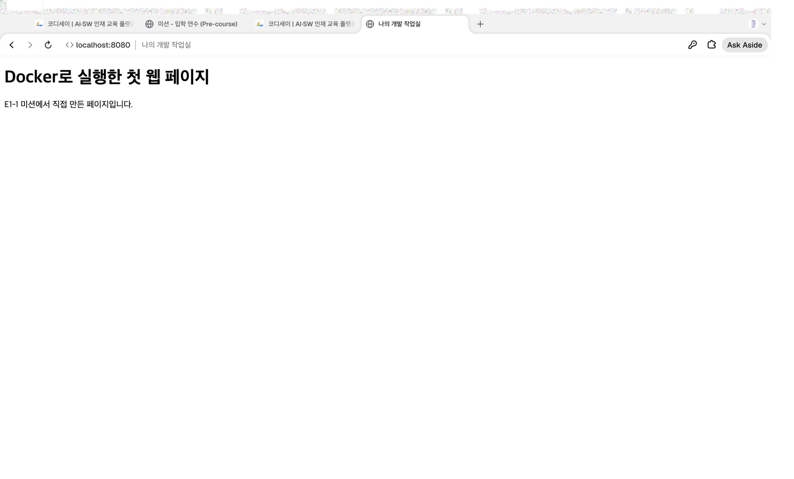
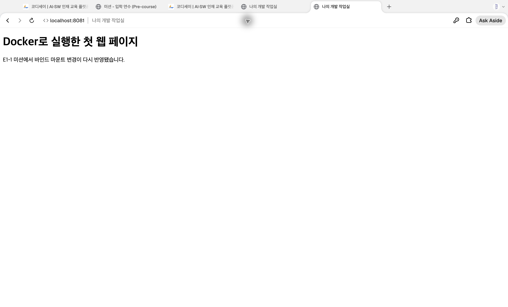
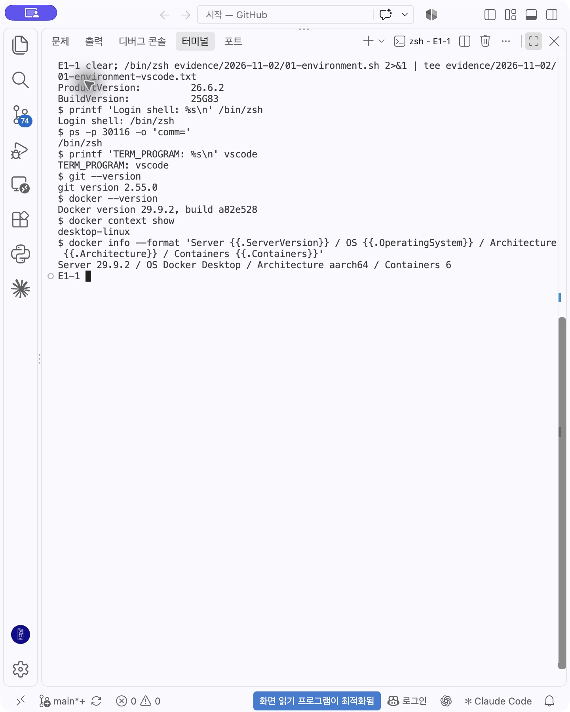
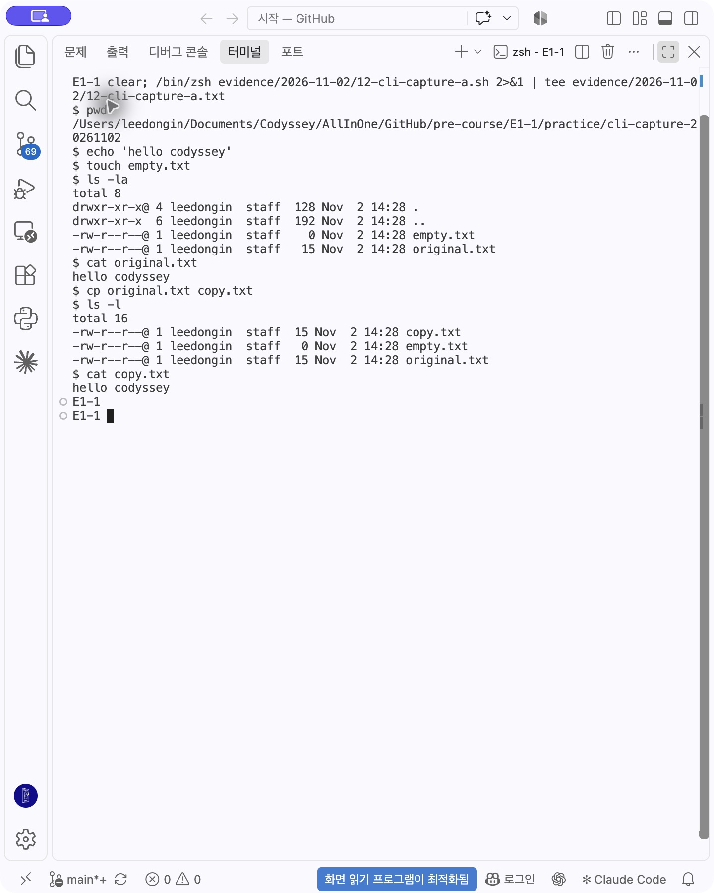
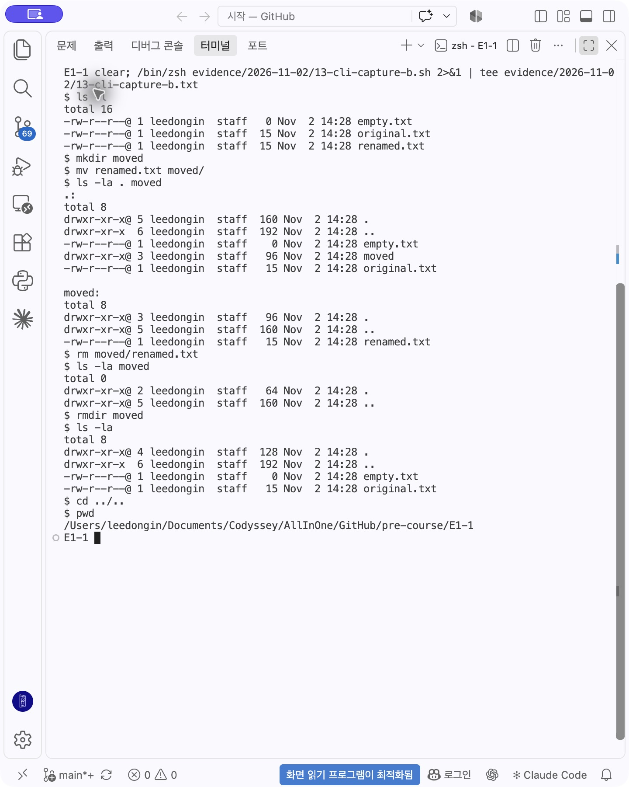
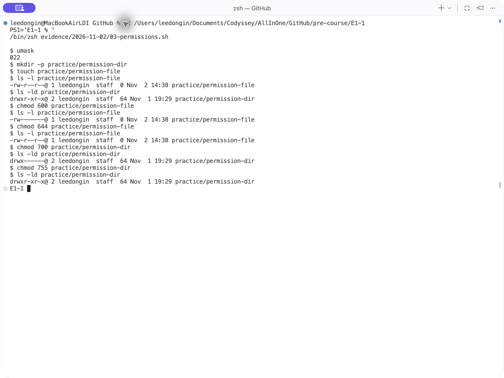
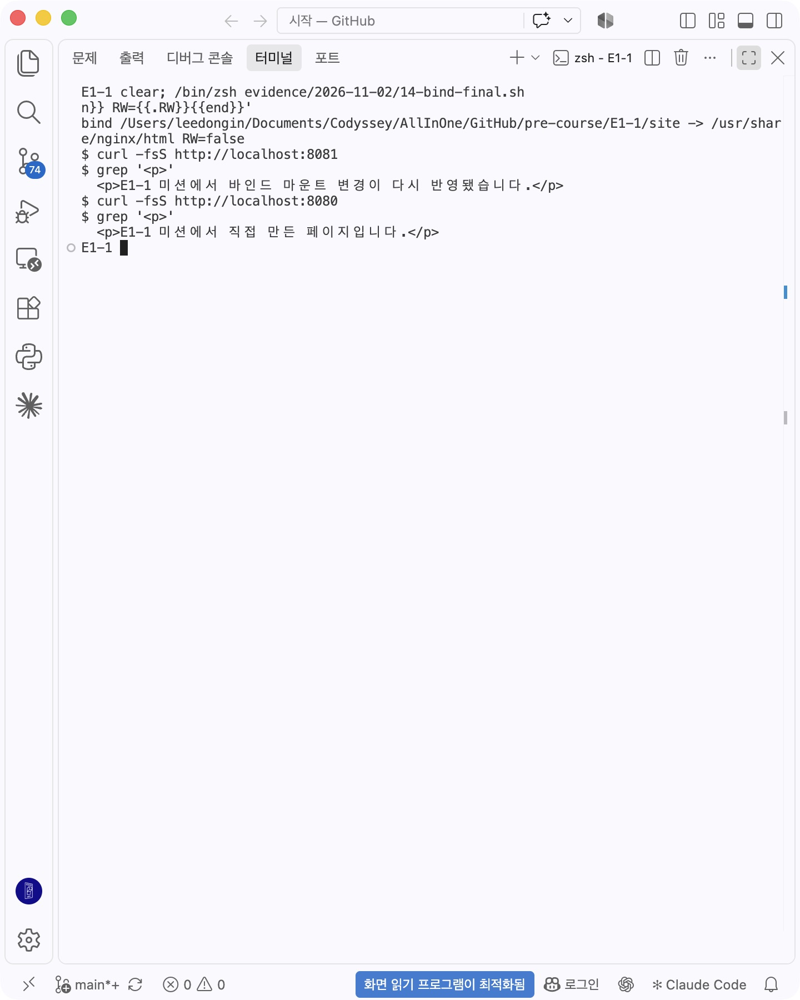
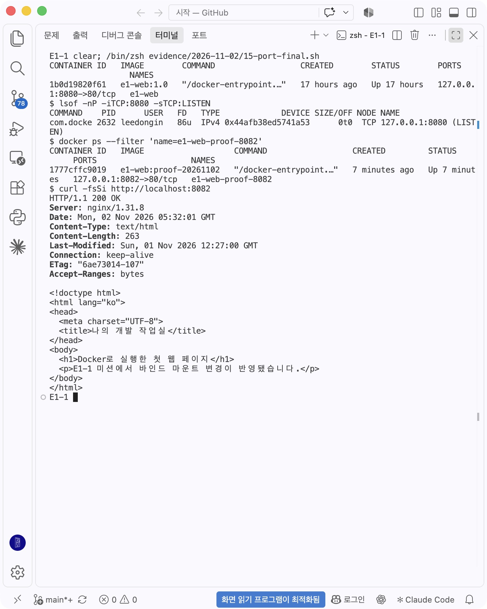
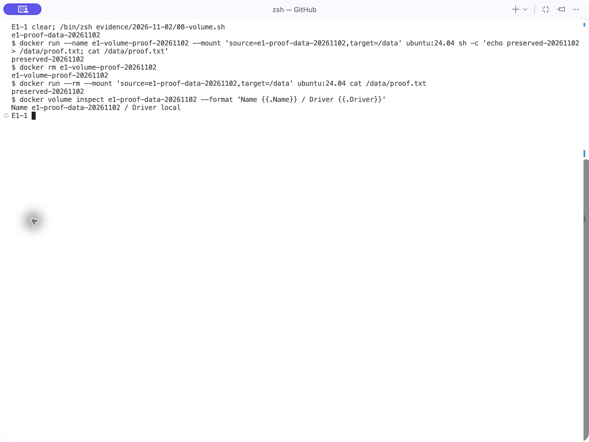

# 증거 사진

2026-11-02 사진은 실제 앱 화면 캡처다. 명령 실행 결과를 그림으로 합성하지 않았다. 터미널은 VS Code 통합 터미널, 웹 접속은 Aside를 사용했다. 파일명 순서는 촬영 시각과 같지 않을 수 있다.

## Aside 실제 8080 접속: 주소창과 최초 웹페이지

## Aside 실제 8081 접속: 주소창과 변경된 바인드 마운트 본문

## VS Code 통합 터미널: OS·셸·TERM_PROGRAM·Git·Docker

## 통합 터미널: 생성·목록·내용 확인·복사

## 통합 터미널: 이름 변경·폴더 이동·파일 및 빈 폴더 삭제

## 통합 터미널: 파일 600→644, 디렉터리 700→755

## 통합 터미널: 실제 마운트 정보와 8080·8081 본문 비교

## 통합 터미널: 포트 점유 진단과 8082 HTTP 200

## 통합 터미널: 볼륨 컨테이너 삭제 후 재연결

## 기존 실습 사진

0.png, 2-1~2-2.png, 3-1~3-2.png, 4-1~4-5.png, 5-1~5-3.png, 6-1~6-6.png, 7-1~7-2.png, 8.png, 9-2.png는 2026-11-01 실습 증거다. 개인정보가 있는 기존 Git 설정 사진 9-1.png는 제출 대상에서 제외하고 이메일을 가린 새 텍스트 로그로 대체했다.
