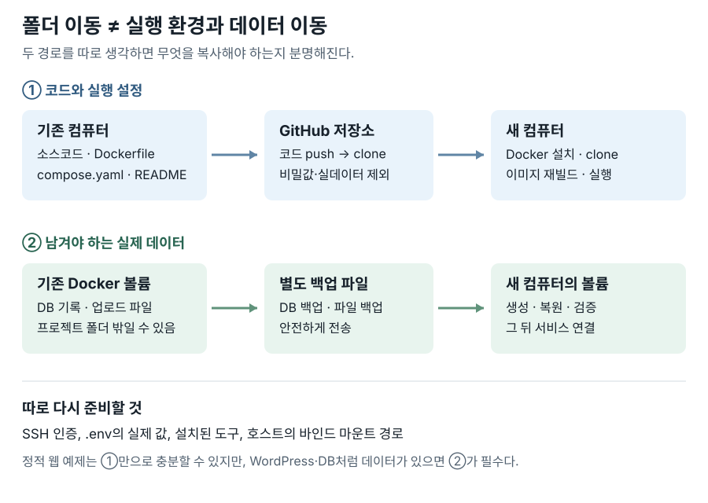
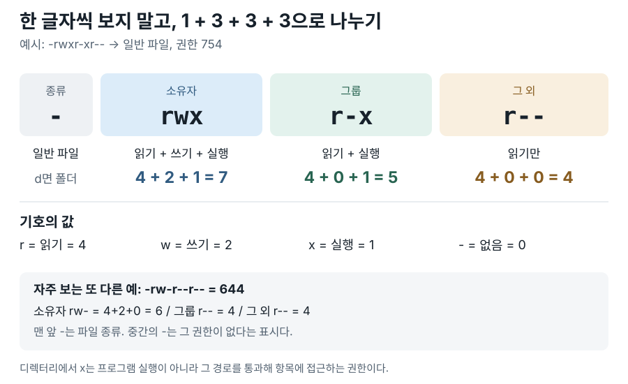

# E1-1 미션 사전 질문과 답변

> 미션: **내 컴퓨터에 개발자용 '작업실' 꾸미기**
> 원문: [Codyssey 입학 연수 미션](https://usr.codyssey.kr/daejeon/learning/learningMap?projectNo=154005)
> 이 문서는 미션을 수행하기 **전**에 떠올린 질문과 대화에서 정리한 답변이다. 명령 실행 결과나 미션 완료 증거가 아니다. 실제 수행 내용은 별도 README에 기록한다.

## 목차

| 번호 | 질문 | 답변 |
| --- | --- | --- |
| 01 | [Docker 외에 다른 선택지는?](#q01) | [답변](#a01) |
| 02 | [다른 컴퓨터로 폴더만 복사하면 이어서 할 수 있나?](#q02) | [답변](#a02) |
| 03 | [Linux를 따로 설치해야 하나?](#q03) | [답변](#a03) |
| 04 | [개발 환경에서 권한을 왜 신경 쓰나?](#q04) | [답변](#a04) |
| 05 | [컨테이너는 무엇을 담나?](#q05) | [답변](#a05) |
| 06 | [Dockerfile에는 무엇이 들어가나?](#q06) | [답변](#a06) |
| 07 | [포트 매핑은 무엇인가?](#q07) | [답변](#a07) |
| 08 | [바인드 마운트와 볼륨의 관계는?](#q08) | [답변](#a08) |
| 09 | [이미지와 컨테이너의 차이는?](#q09) | [답변](#a09) |
| 10 | [포트와 스토리지 연결은 같은 것인가?](#q10) | [답변](#a10) |
| 11 | [Docker의 핵심은 재현성인가?](#q11) | [답변](#a11) |
| 12 | [CI/CD는 무엇인가?](#q12) | [답변](#a12) |
| 13 | [클라우드로 어떻게 이어지나?](#q13) | [답변](#a13) |
| 14 | [셸과 터미널은 어떻게 다른가?](#q14) | [답변](#a14) |
| 15 | [절대·상대 경로와 CLI의 관계는?](#q15) | [답변](#a15) |
| 16 | [권한 숫자와 `-` 기호는 어떻게 읽나?](#q16) | [답변](#a16) |
| 17 | [Docker와 Docker Compose는 어떻게 다른가?](#q17) | [답변](#a17) |
| 18 | [멀티 컨테이너에서 Compose가 하는 일은?](#q18) | [답변](#a18) |
| 19 | [GitHub SSH 연결은 어떻게 증명하나?](#q19) | [답변](#a19) |
| 20 | [AI 활용에 적합한 맥 터미널은?](#q20) | [답변](#a20) |
| 21 | [민감정보를 처음부터 출력하지 않으려면?](#q21) | [답변](#a21) |

---

<a id="q01"></a>
### 01. Docker 외에 다른 선택지는?

**질문.** Docker를 사용하고 대략 격리된 환경이라는 점은 이해하지만, 다른 서비스는 없을까? [답변으로 이동](#a01)

<a id="a01"></a>
**답변.** 컨테이너를 만들고 실행하는 도구로는 **Podman** 등이 있다. macOS에서 Docker 방식의 컨테이너를 실행할 환경으로는 **Docker Desktop, OrbStack, Colima** 등이 있다. 이들은 모두 같은 종류의 대안은 아니다. 예를 들어 OrbStack은 Docker 엔진을 포함하므로 `docker` 명령을 계속 쓸 수 있는 macOS용 실행 환경이다. 이번 미션은 `docker` 명령과 Dockerfile을 요구하므로, 우선 과제에서 안내한 OrbStack 또는 호환되는 Docker 환경을 사용하는 편이 간단하다. [OrbStack 문서](https://docs.orbstack.dev/docker) · [Colima 소개](https://colima.run/)

<a id="q02"></a>
### 02. 다른 컴퓨터로 폴더만 복사하면 이어서 할 수 있나?

**질문.** 공용 컴퓨터에서 하던 작업을 다른 컴퓨터에서도 하려면 폴더만 그대로 복사하면 될까? [답변으로 이동](#a02)

<a id="a02"></a>
**답변.** 먼저 **코드/설정**과 **실제 운영 데이터**를 분리해서 생각한다.



1. **코드 경로:** 소스코드, `Dockerfile`, `compose.yaml`, README를 GitHub에 올리거나 폴더로 복사한다. 새 컴퓨터에 Docker 실행 환경을 설치하고 저장소를 받은 뒤 이미지를 다시 빌드하고 컨테이너를 새로 실행한다. 공개 이미지를 쓰는 경우에는 다시 내려받는다.
2. **데이터 경로:** 기존 **Docker 볼륨은 프로젝트 폴더 밖에서 Docker가 관리**하므로 코드 복사만으로 옮겨지지 않는다. 보존할 DB·업로드 파일은 서비스에 맞게 백업한다. 새 컴퓨터에 볼륨을 만들고 데이터를 복원한 뒤 서비스에 연결하여 내용이 맞는지 확인한다. 특히 WordPress의 DB는 단순 파일 복사보다 일관된 DB 백업·복원 절차를 우선 고려한다.
3. **컴퓨터별 설정:** SSH 인증, 실제 환경 변수/비밀값, 도구 설치, 바인드 마운트의 호스트 경로는 새 컴퓨터에 맞춰 안전하게 다시 설정한다. 개인키나 `.env` 실값을 GitHub에 넣지 않는다.

정적 웹 페이지처럼 보존할 운영 데이터가 없는 과제라면 ①만으로 재현될 수 있지만, WordPress와 DB를 운영한다면 ②도 필요하다. **컨테이너를 삭제해도 같은 컴퓨터의 볼륨은 남을 수 있지만, 다른 컴퓨터로 저절로 전송되지는 않는다.** [Docker 볼륨 문서](https://docs.docker.com/engine/storage/volumes/) · [바인드 마운트 문서](https://docs.docker.com/engine/storage/bind-mounts/)

<a id="q03"></a>
### 03. Linux를 따로 설치해야 하나?

**질문.** 미션에 Linux CLI가 언급되는데, 현재 맥 로컬 터미널로 할 수 있지 않을까? [답변으로 이동](#a03)

<a id="a03"></a>
**답변.** 맥에 Linux를 별도로 설치할 필요는 없어 보인다. macOS 터미널에서 `pwd`, `cd`, `ls`, `chmod` 등 유닉스 계열 명령을 실습할 수 있고, OrbStack은 내부 Linux 가상 환경에서 Docker 엔진을 실행한다. 다만 맥의 기본 도구는 BSD 계열, 일반적인 Ubuntu의 기본 도구는 GNU 계열인 경우가 많아 **같은 명령의 옵션이 다를 수 있다**. 아래는 기본 도구를 쓰는 경우의 예다. 설치한 버전에 따라 달라질 수 있으므로 `man`으로 확인한다.

| 목적 | macOS 기본 도구 | Ubuntu의 GNU 도구 |
| --- | --- | --- |
| 파일 크기 출력 | `stat -f %z file.txt` | `stat -c %s file.txt` |
| 파일 내용 제자리 치환 | `sed -i '' 's/old/new/' file.txt` | `sed -i 's/old/new/' file.txt` |
| `ls` 색상 표시 | `ls -G` | `ls --color=auto` |

기본 실습의 `pwd`, `cd`, `ls -la`, `chmod 644`는 두 환경에서 대체로 비슷하게 쓸 수 있다. 하지만 macOS의 `ls -l`에서는 ACL을 뜻하는 `+`, 확장 속성을 뜻하는 `@` 등이 추가로 보일 수 있다. README에 **OS와 셸을 정확히 기록**하고, Linux의 실제 출력을 보고 싶다면 Ubuntu 컨테이너 안에서도 실습하자. [OrbStack 구조](https://docs.orbstack.dev/architecture) · [BSD/GNU 명령 차이 예시](https://cloudstreet-dev.github.io/macOS-and-Unix/part6-commands/bsd-vs-gnu.html)

<a id="q04"></a>
### 04. 개발 환경에서 권한을 왜 신경 쓰나?

**질문.** 평소에는 운영체제가 폴더 권한을 알아서 관리하는데, 개발할 때는 왜 직접 정리할까? [답변으로 이동](#a04)

<a id="a04"></a>
**답변.** 운영체제는 *설정된* 권한을 집행하지만, 어떤 사용자나 프로세스가 무엇을 읽고 실행하고 수정해도 되는지는 개발자가 결정해야 할 때가 있다. 예를 들어 웹 서버가 정적 파일은 읽되 비밀 설정은 함부로 읽지 못하게 하거나, 호스트와 컨테이너의 사용자 차이로 발생한 쓰기 오류를 해결해야 한다. 디렉터리에 들어가려면 `x` 권한도 중요하다. 문제를 `chmod 777`로 덮기보다는 필요한 권한만 부여하는 것이 안전하다. [GNU 권한 숫자 설명](https://www.gnu.org/software/coreutils/manual/html_node/Numeric-Modes.html)

<a id="q05"></a>
### 05. 컨테이너는 무엇을 담나?

**질문.** 화물 운반 용기라는 뜻의 container가 컴퓨터에서는 무엇을 담는다는 뜻일까? [답변으로 이동](#a05)

<a id="a05"></a>
**답변.** 정확히는 **컨테이너 = 이미지에서 생성한 실행 가능한 인스턴스**다. 이미지는 파일시스템 내용과 실행 설정을 담고, 컨테이너는 그 이미지를 바탕으로 생성되어 자체 상태와 쓰기 영역을 갖는다. 실행하면 그 안에서 프로세스가 동작한다. 즉, '애플리케이션 전체가 다른 OS에 담긴다'기보다 프로그램과 의존 파일을 격리된 실행 단위로 다룬다. Linux 컨테이너는 같은 Linux 커널을 공유하면서 프로세스·파일시스템·네트워크 등을 분리한다.

**인스턴스(instance)**는 일반적으로 어떤 정의·틀에서 **실제로 생성된 개별 개체**라는 뜻이다. 독립적인 하나의 개체라는 이해가 대체로 맞지만, 완전히 독립된 컴퓨터라는 뜻은 아니다. `nginx:alpine` 이미지 하나로 `web-a`와 `web-b` 컨테이너를 만들면 두 개는 서로 다른 인스턴스다. 각각 별도의 이름·상태·쓰기 영역을 가지지만 베이스 이미지의 내용을 공유한다. [Docker 용어집](https://docs.docker.com/reference/glossary/) · [컨테이너 데이터 설명](https://docs.docker.com/get-started/docker-concepts/running-containers/persisting-container-data/)

<a id="q06"></a>
### 06. Dockerfile에는 무엇이 들어가나?

**질문.** Dockerfile은 무슨 내용으로 구성될까? [답변으로 이동](#a06)

<a id="a06"></a>
**답변.** 컨테이너 **이미지를 만드는 지시문**을 적는다. 예를 들어 아래는 NGINX 이미지에 정적 웹 파일을 복사하는 최소 예시다. 아직 이 미션에서 실행해 검증한 결과는 아니다.

```Dockerfile
FROM nginx:alpine
COPY site/ /usr/share/nginx/html/
EXPOSE 80
```

`FROM`은 베이스 이미지, `COPY`는 파일 복사, `EXPOSE`는 이미지가 사용할 포트를 알리는 설명이다. `EXPOSE`만으로 호스트에 포트가 공개되지는 않으며 실행할 때 `-p` 설정이 필요하다. 그 밖에 `RUN`, `WORKDIR`, `ENV`, `USER`, `CMD` 등을 목적에 따라 쓴다.

**Dockerfile과 이미지가 분리된 이유:** Dockerfile은 *만드는 방법을 기록한 텍스트 파일*이고, 이미지는 `docker build`가 그 지시문과 빌드에 필요한 파일들을 처리해 만든 *실제 실행용 산출물*이다. 같은 Dockerfile이라도 `site/` 내용이나 베이스 이미지가 바뀌면 다른 이미지가 만들어질 수 있다. Dockerfile은 Git으로 변경을 추적하기 쉽고, 만들어진 이미지는 레지스트리로 배포하거나 여러 컨테이너의 시작점으로 재사용할 수 있다. 빌드 없이 Dockerfile 자체를 `docker run`으로 실행하는 것은 아니다. [Dockerfile 지시문](https://docs.docker.com/reference/dockerfile/) · [이미지 빌드](https://docs.docker.com/get-started/docker-concepts/building-images/build-tag-and-publish-an-image/)

<a id="q07"></a>
### 07. 포트 매핑은 무엇인가?

**질문.** 여기서 포트는 하드웨어가 아니라 네트워크상의 논리적 포트일 텐데, 포트 매핑은 무엇을 연결할까? [답변으로 이동](#a07)

<a id="a07"></a>
**답변.** 맞다. 호스트의 네트워크 포트와 컨테이너 내부 서비스의 포트를 연결한다. 예를 들어 `docker run -p 127.0.0.1:8080:80 nginx`라면 내 컴퓨터의 `localhost:8080`으로 온 요청이 컨테이너의 `80`번 포트에 전달된다. `8080:80`에서는 **왼쪽이 호스트, 오른쪽이 컨테이너**다. IP를 생략하면 외부 네트워크 인터페이스에도 공개될 수 있으므로 실습에서 로컬만 필요하다면 `127.0.0.1`을 지정하는 편이 안전하다. [Docker 포트 공개 문서](https://docs.docker.com/get-started/docker-concepts/running-containers/publishing-ports/)

<a id="q08"></a>
### 08. 바인드 마운트와 볼륨의 관계는?

**질문.** 마운트/볼륨은 저장 장치와 관련된 것으로 아는데, 바인드 마운트의 변경 반영과 볼륨의 데이터 영속성은 각각 무엇을 검증할까? [답변으로 이동](#a08)

<a id="a08"></a>
**답변. 먼저 용어부터 구분한다.**

- **마운트(mount):** 어떤 파일시스템의 파일·디렉터리를 **다른 경로에서 접근 가능하도록 연결하는 행위 또는 연결 상태**다. Docker에서는 컨테이너 내부 경로에 호스트 쪽 저장 공간 등을 붙인다고 이해하면 된다.
- **바인드 마운트(bind mount):** 호스트에 **이미 있는 특정 파일이나 디렉터리 경로**를 컨테이너의 경로에 연결하는 마운트 방식이다. 예: 맥의 `./site` → 컨테이너의 `/usr/share/nginx/html`.
- **볼륨(volume):** Docker가 생성·관리하는 **이름 붙은 영속 저장 공간**이다. 볼륨을 컨테이너 경로에 연결하는 행위도 *볼륨 마운트*다. 예: `mydata` → 컨테이너의 `/data`. 따라서 '마운트'는 연결 동작이고, '볼륨'은 연결할 저장 공간의 한 종류다.

**서로 다른 두 검증:** 바인드 마운트 실습은 호스트의 `./site`를 고친 뒤 컨테이너가 변경된 파일을 보는지 확인한다. 볼륨 실습은 컨테이너가 `mydata`에 파일을 쓰고, 그 컨테이너를 삭제한 후 새 컨테이너에 **같은 볼륨**을 붙여 파일이 남아 있는지 확인한다. 영속성은 **컨테이너 삭제와 데이터 삭제를 분리한다**는 뜻이지 무한 보존을 뜻하지 않는다. 볼륨 자체의 삭제나 디스크 고장에는 백업이 필요하다. [바인드 마운트](https://docs.docker.com/engine/storage/bind-mounts/) · [볼륨](https://docs.docker.com/engine/storage/volumes/)

<a id="q09"></a>
### 09. 이미지와 컨테이너의 차이는?

**질문.** 컨테이너 안에 이미지가 쌓이는 것일까? [답변으로 이동](#a09)

<a id="a09"></a>
**답변.** 순서는 **Dockerfile과 빌드에 쓰는 파일 → `docker build` → 이미지 → `docker run` → 컨테이너**다.

- **이미지(image):** 컨테이너를 생성할 때 사용하는 읽기 전용 파일시스템 계층과 실행 설정의 묶음이다. 실행 중인 프로세스 자체는 아니다.
- **컨테이너(container):** 이미지에서 생성된 개별 실행 가능 단위다. 이미지의 내용 위에 그 컨테이너만의 쓰기 영역과 실행 상태가 더해진다. 같은 이미지로 여러 컨테이너를 만들 수 있다.

따라서 이미지가 컨테이너 안에 쌓이는 게 아니다. **이미지 자체가 여러 계층으로 구성**될 수 있다는 표현과 혼동하지 말자. 컨테이너 자체 쓰기 영역에 저장한 데이터는 그 컨테이너 삭제 시 사라지므로 보존할 데이터는 볼륨이나 바인드 마운트 같은 외부 저장소에 둔다. [Docker 용어집](https://docs.docker.com/reference/glossary/) · [Docker 저장소 설명](https://docs.docker.com/engine/storage/)

<a id="q10"></a>
### 10. 포트와 스토리지 연결은 같은 것인가?

**질문.** 포트가 소프트웨어/네트워크 포트라면 스토리지 연결 때문에 바인드 마운트와 볼륨이 함께 나오는 걸까? [답변으로 이동](#a10)

<a id="a10"></a>
**답변.** 같은 기능은 아니지만 **컨테이너의 경계와 외부를 연결**한다는 공통점이 있다. 포트 매핑은 네트워크 요청이 드나드는 경로이고, 마운트·볼륨은 파일과 데이터가 놓이는 경로다. WordPress라면 방문자가 웹사이트에 접속하는 것은 포트, 업로드 파일과 데이터베이스 내용을 유지하는 것은 저장소 쪽 문제다. 각각 독립적으로 설정하고 검증한다. [포트 공개](https://docs.docker.com/get-started/docker-concepts/running-containers/publishing-ports/) · [스토리지](https://docs.docker.com/engine/storage/)

<a id="q11"></a>
### 11. Docker의 핵심은 재현성인가?

**질문.** Docker는 재현성이 핵심일까? [답변으로 이동](#a11)

<a id="a11"></a>
**답변.** **재현 가능한 실행 환경을 만들기 쉽게 하는 것**이 큰 장점이다. 그러나 Docker를 쓴다고 저절로 완벽히 재현되는 것은 아니다. 베이스 이미지 버전, CPU 아키텍처, 환경 변수, 포트·마운트 설정, 외부 서비스, 볼륨 데이터까지 고려해야 한다. 코드와 실행 구성을 기록하고 다른 컴퓨터에서 동일 절차를 다시 실행해 보는 것이 진짜 검증이다. [Docker 이미지 빌드](https://docs.docker.com/get-started/docker-concepts/building-images/build-tag-and-publish-an-image/)

<a id="q12"></a>
### 12. CI/CD는 무엇인가?

**질문.** 지속적인 통합과 배포로 알고 있는데 맞나? 안정적인 운영을 뜻할까? [답변으로 이동](#a12)

<a id="a12"></a>
**답변.** CI는 **지속적 통합**으로, 코드 변경 때 빌드·테스트 등을 자동 실행해 변경이 합쳐져도 동작하는지 확인하는 흐름이다. CD는 문맥에 따라 **지속적 전달** 또는 **지속적 배포**를 뜻한다. 배포 가능한 상태까지 자동으로 준비할 수도 있고, 운영 환경 배포까지 자동화할 수도 있다. 안정적 운영에 도움이 되지만 CI/CD 자체가 안정성을 보장하지는 않는다. Docker 이미지가 일정한 빌드·실행 단위를 제공해 이런 자동화에 활용되기 쉽다. [GitHub Actions](https://github.com/features/actions)

<a id="q13"></a>
### 13. 클라우드로 어떻게 이어지나?

**질문.** 집의 노트북에서 Docker Compose로 운영하는 WordPress 서버를 클라우드로 옮길까 고민 중인데, 이 미션 경험과 어떻게 연결될까? [답변으로 이동](#a13)

<a id="a13"></a>
**답변.** 클라우드 서버에서도 이미지와 Compose 구성을 이용해 서비스를 다시 실행할 수 있다는 점이 연결된다. 다만 **서버 설정만 옮긴다고 기존 사이트 데이터가 따라오지는 않는다.** WordPress 업로드 파일과 DB 데이터를 백업·복원하고, 비밀정보·도메인·HTTPS·방화벽·백업·업데이트를 별도로 계획해야 한다. 이 미션의 포트, 볼륨, 재현성은 이전 계획의 기초다. 운영 중인 사이트의 이전은 미션 실습보다 복잡하므로 백업 복원 테스트와 전환·롤백 계획 없이 기존 서버를 중지하지 않는다. [Docker 볼륨 백업·이전](https://docs.docker.com/engine/storage/volumes/#back-up-restore-or-migrate-data-volumes)

<a id="q14"></a>
### 14. 셸과 터미널은 어떻게 다른가?

**질문.** 셸과 터미널이 비슷해 보인다. 셸은 서버에서 명령을 실행하는 CLI 환경인가? [답변으로 이동](#a14)

<a id="a14"></a>
**답변.** **터미널**은 글자 기반으로 명령을 입력하고 결과를 보여 주는 앱이며, **셸**은 입력한 명령을 해석하고 실행하는 프로그램이다. macOS의 Terminal.app에서 `zsh`를 사용할 수 있고, 다른 터미널 앱에서 같은 `zsh`를 쓸 수도 있다. 원격 서버에 SSH로 접속했을 때도 그 서버의 셸을 사용한다. 따라서 SSH(원격 접속 방식), 터미널(입출력 창), 셸(명령 해석기)은 서로 다른 층이다.

<a id="q15"></a>
### 15. 절대·상대 경로와 CLI의 관계는?

**질문.** 절대 경로는 전체 경로, 상대 경로는 특정 폴더부터 시작하는 경로로 이해한다. 이번 미션에서는 CLI와 가까워져야 할까? [답변으로 이동](#a15)

<a id="a15"></a>
**답변.** 이해한 방향이 맞다. `/Users/me/project/README.md`는 시작점이 정해진 절대 경로이고, `./README.md`나 `../other`는 **현재 작업 위치**를 기준으로 해석되는 상대 경로다. `pwd`로 현재 위치를 확인하고 `cd`, `ls -la`로 이동과 결과를 검증하는 습관을 들이자. 명령을 암기하는 것보다 **지금 어디서 어떤 파일을 조작하는지** 아는 것이 중요하다.

<a id="q16"></a>
### 16. 권한 숫자와 `-` 기호는 어떻게 읽나?

**질문.** 세 자리 숫자와 `-r`처럼 보이는 표기를 시각적으로 이해하고 외우고 싶다. [답변으로 이동](#a16)

<a id="a16"></a>
**답변.** `ls -l`의 권한 표기는 **파일 종류 1자리 + 소유자·그룹·그 외 각각 3자리**로 잘라 읽는다. 먼저 그림의 네 칸을 순서대로 본다.



**읽는 순서:** `-rwxr-xr--`에서 맨 앞 `-`는 **일반 파일**이다. 뒤의 `rwx`는 **소유자**가 읽기·쓰기·실행 가능, `r-x`는 **그룹**이 읽기·실행 가능, `r--`는 **그 외 사용자**가 읽기만 가능하다는 뜻이다. 이 순서가 `소유자/그룹/그 외 = 7/5/4`, 즉 **754**다.

| 묶음 | 글자 | 계산 | 숫자 |
| --- | --- | --- | --- |
| 소유자 | `rwx` | 4 + 2 + 1 | 7 |
| 그룹 | `r-x` | 4 + 0 + 1 | 5 |
| 그 외 | `r--` | 4 + 0 + 0 | 4 |

`r=4`, `w=2`, `x=1`, `-=0`을 기억하면 된다. **맨 앞의 `-`는 일반 파일이라는 종류**, 권한 묶음 안의 `-`는 **그 권한이 없음**이라는 뜻이라 서로 역할이 다르다. 맨 앞이 `d`면 디렉터리다. 따라서 `drwxr-xr-x`는 **디렉터리, 755**, `-rw-r--r--`는 **일반 파일, 644**다.

파일에서 `x`는 실행, 디렉터리에서 `x`는 경로를 통과해 항목에 접근할 수 있다는 뜻이다. 디렉터리의 `r`은 이름 목록 확인, `w`는 항목 변경과 관련되며 보통 `x`도 함께 필요하다. macOS 출력 끝의 `@`·`+`는 추가 속성·ACL을 나타낼 수 있다. **실습할 때는 `ls -ld 경로`로 디렉터리 자체의 권한을 확인**한다. [GNU 숫자 권한 설명](https://www.gnu.org/software/coreutils/manual/html_node/Numeric-Modes.html)

<a id="q17"></a>
### 17. Docker와 Docker Compose는 어떻게 다른가?

**질문.** 집 노트북에서 Compose를 쓰고 있는데 Docker와는 무엇이 다를까? [답변으로 이동](#a17)

<a id="a17"></a>
**답변.** Docker는 이미지 빌드와 컨테이너 실행·관리를 위한 기반 도구다. **Docker Compose**는 `compose.yaml` 같은 파일에 서비스의 이미지, 빌드 방법, 포트, 볼륨, 네트워크 등을 선언하고 `docker compose up`으로 **한꺼번에 구성·실행·관리**한다. Dockerfile이 이미지를 *만드는 방법*이라면 Compose 파일은 컨테이너를 *어떻게 실행하고 연결할지*에 가깝다. 단일 서비스에도 쓸 수 있다.

다음은 위 [Dockerfile 예시](#q06)와 `site/` 폴더가 같은 프로젝트 안에 있다고 가정한 **학습용 단일 웹 서버 예시**다. 실제 실행 결과는 아니다.

```yaml
# compose.yaml
services:
  web:
    build: .                     # 현재 폴더의 Dockerfile로 이미지 빌드
    ports:
      - "127.0.0.1:8080:80"      # 맥의 8080 → 컨테이너의 80
```

`docker compose up -d --build`를 실행하면 이미지를 빌드하고 `web` 서비스를 실행한다. 브라우저에서 `http://localhost:8080`으로 접속해 볼 수 있다. 서비스 둘을 조합하는 예시는 [18번 답변](#a18)을 참고한다. [Docker Compose 개념](https://docs.docker.com/get-started/docker-concepts/the-basics/what-is-docker-compose/)

<a id="q18"></a>
### 18. 멀티 컨테이너에서 Compose가 하는 일은?

**질문.** 보너스 과제의 멀티 컨테이너를 보니 '작곡하다'처럼 여러 개를 합친다는 뜻이 느껴진다. [답변으로 이동](#a18)

<a id="a18"></a>
**답변.** 좋은 비유다. 예를 들어 **웹 서버와 DB**를 각자의 컨테이너로 실행하면서, 두 서비스가 사용할 네트워크와 볼륨, 포트 등의 관계를 하나의 Compose 파일에 정의한다. 각 컨테이너를 무조건 하나로 합치는 것이 아니라, **분리된 서비스들을 함께 동작하도록 조율**하는 것이다. `docker compose up`, `ps`, `logs`, `down`으로 구성 전체를 관리한다. [Docker Compose 개념](https://docs.docker.com/get-started/docker-concepts/the-basics/what-is-docker-compose/)

<a id="q19"></a>
### 19. GitHub SSH 연결은 어떻게 증명하나?

**질문.** 이미 로컬과 GitHub를 SSH로 연결해 쓰는데, 어떤 증거를 남길까? [답변으로 이동](#a19)

<a id="a19"></a>
**답변.** `git remote -v`에서 `git@github.com:...` 형식의 원격 주소, `ssh -T git@github.com`에서 인증 성공 메시지, 실제 `git push` 결과를 기록하면 된다. `ssh -T` 성공 메시지에 'shell access를 제공하지 않는다'는 문구가 나오는 것은 정상이다. **SSH 개인키를 열거나 촬영하지 않는다.** 계정명·이메일을 공개하기 싫다면 가리고, 미션에서 VS Code 연동 증거를 별도로 요구하므로 해당 화면도 민감정보 없이 기록한다. [GitHub SSH 테스트](https://docs.github.com/en/authentication/connecting-to-github-with-ssh/testing-your-ssh-connection?platform=mac)

<a id="q20"></a>
### 20. AI 활용에 적합한 맥 터미널은?

**질문.** CLI에 익숙해지고 싶은데, 맥 기본 터미널 외에 AI 활용에 적합한 터미널은 없을까? [답변으로 이동](#a20)

<a id="a20"></a>
**답변.** **Warp**는 AI 명령 제안과 오류 설명 기능이 있는 터미널 후보이고, VS Code 통합 터미널도 코드 옆에서 명령을 실습하기 좋다. 그러나 이 미션에서는 어떤 터미널을 쓰든 **명령의 의미를 이해하고 직접 입력·검증**하는 편이 학습 목적에 맞다. AI가 제안한 명령은 실행 전에 읽고, 로그나 비밀정보를 무심코 AI 입력창에 넣지 않도록 주의한다. 터미널 앱과 셸은 별개이므로 터미널을 바꿔도 `zsh`를 계속 쓸 수 있다. [Warp AI 소개](https://www.warp.dev/warp-ai)

<a id="q21"></a>
### 21. 민감정보를 처음부터 출력하지 않으려면?

**질문.** 애초에 민감정보는 입출력하지 않도록 주의하고 싶다. [답변으로 이동](#a21)

<a id="a21"></a>
**답변.** 좋은 출발점이다. `.env`, SSH 개인키, 토큰, 비밀번호, 인증 코드를 README·스크린샷·Git에 올리지 않는다. `.gitignore`에 비밀 파일을 추가하고, 공유할 설정 형식만 `.env.example`에 **가짜 값**으로 기록한다. `git config --list`, `docker inspect`, 전체 터미널 캡처 등은 예상보다 많은 값을 노출할 수 있으므로 제출 전 내용을 확인해 필요한 부분만 남긴다. 이미 유출했다면 문서에서 가리는 것만으로 끝나지 않으므로 해당 비밀을 폐기·재발급하고 Git 기록과 공개 범위를 점검한다. 이번 미션은 실제 비밀값보다 **명령과 검증 결과**가 증거다.

---

## 미션을 시작할 때의 순서

1. macOS·셸·터미널을 기록하고 경로와 권한을 실습한다.
2. 이미지와 컨테이너를 구분하며 Docker 기본 명령을 실행한다.
3. 직접 Dockerfile을 작성하고 커스텀 이미지를 빌드한다.
4. 포트 매핑으로 웹 서버에 접속한다.
5. 바인드 마운트의 변경 반영과 볼륨의 컨테이너 삭제 전후 영속성을 **각각** 검증한다.
6. GitHub에 코드·README·증거를 올리고 SSH 및 VS Code 연동을 확인한다.
7. 트러블슈팅 최소 2건과 민감정보 점검을 마친다.

> **구분:** 이 파일은 사전 개념 정리다. 실제 명령 출력, 스크린샷, 실행 환경의 버전, 검증 증거는 과제 제출용 README에 별도로 기록한다.
